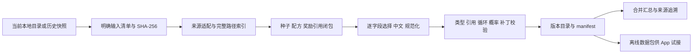

> 历史归档：本篇保留当时的版本、路径与验收结果；当前规范请从 [文档总览](../../README.md) 阅读。

# P3 离线小闭环与“合并汇总”

适用版本：SourceWorkbench 0.8.0；实现及验收日期：2026-10-22。

配套文档：[数据规范与字段映射](17-P3数据规范与字段映射.md)、[验收与协作指南](18-P3验收与协作指南.md)、[本地图片与官方图片分析](19-本地图片接入与官方图片获取分析.md)。

## 本次交付目标

先用本地固定输入走通“读取 → 统一实体 → 中文 → 配方／奖励 → 校验 → 版本化导出 → 工作台查看”的完整流程。新增顶层入口“合并汇总”，与原始资料浏览并列。原始资料继续只读；构建产物独立保存。

本轮不建设 uniCloud 数据库、ECS HTTP 服务、App 网络更新或邮件发送。仓鼠互助洞 App 可以先用导出的离线文件验证数据消费；后续安卓、H5、iOS 共用同一份数据规范。

## 范围为什么这样选

首批种子是迅发电浆炮 Acceltra 和 Gauss，另加入扎里曼 A 档的一张完整奖励表。沿配方成品、材料和奖励物品继续扩展引用，直到闭合，而不是手抄几个孤立物品。武器检验暴击、射速、紫卡系数，战甲检验能量容量，材料检验配方关系，奖励检验现金、内融核心和蓝图命名。

范围由 `src/data/merge-contract.json` 固定，最大 300 实体。当前扩展结果为 51 实体、14 配方、1 张奖励表、8 个奖励项、60 条关系。资源包含中间部件和可制作材料，因此配方数多于两件种子装备。当前 Mod 文件为空，留出稳定文件布局；不表示 Mod 已经统一。



## 桌面操作

1. 在“资料浏览”打开本项目根目录或 `世界状态上游`。也可以在“更新与版本”选择已完整导入的历史快照。
2. 打开“合并汇总”，点击“构建小闭环”。构建当前选择的数据；不会自动联网上游。
3. “统一资料”按类型筛选、按中文／英文／完整路径搜索，等尺寸卡片不展示描述。点击后仍是完整卡片，展示规范字段、中文释义、所有候选值和原值。
4. 展开“字段来源”，查看采用／候选文件、JSON Pointer、转换规则及哈希。点击“打开来源”回到原 JSON 的对应位置。若本地文件已变化而与构建哈希不同，拒绝跳到不匹配的数据，提示重新构建或选择历史快照。
5. 在“关联关系”跳转配方、成品、材料。“来源完整记录与未建模字段”保留各来源的全部字段，用于继续建模。
6. “赏金奖励”展示完整静态奖励表；“问题与覆盖”展示冲突、缺译、可选文件缺失和未建模字段；“构建差异”比较上一份成功构建。
7. 点击“导出数据包”，选择父目录，生成 `SourceWorkbench-data-<版本前12位>` 子目录。点击“复制清单”取得 manifest，不复制整个资料包。

切换本地目录或快照后，旧页面状态清空，构建仓库也按上下文隔离。重复构建相同内容会复用同一版本，比较基线保持不变。首次构建明确显示空基线，不把全部实体称为一次历史更新。

## 命令行复现

在项目根目录执行，Node.js 22.19+：

```bash
npm ci
npm run build:data -- --root . --store artifacts/p3-build-store --out artifacts/p3-delivery
```

`--root` 可指向包根目录或资料根目录；`--store` 为运行仓库；`--out` 是导出父目录。省略 `--store` 使用 `.workbench`，省略 `--out` 只构建不另行导出。还支持：

```bash
npm run build:data -- --store /path/to/store --release <完整原始快照ID> --out /path/to/delivery
npm run build:data -- --root . --overrides /path/to/reviewed-overrides.json --out /path/to/delivery
```

`--release` 从指定 Store 读原始资料快照，不能填 P3 datasetVersion。CLI 与桌面调用同一构建核心，但默认运行仓库位置不同。

## 产物布局

```text
SourceWorkbench-data-<版本前12位>/
├── manifest.json                 # 规范、映射、构建器、输入及输出哈希
├── contract.json                 # 本次字段和范围规范
├── overrides.json                # 本次采用的人工规则，默认空
├── items/
│   ├── weapons.json              # 1
│   ├── warframes.json            # 1
│   ├── resources.json            # 35，含资源／部件／数量包
│   ├── blueprints.json           # 14，蓝图有独立实体 ID
│   └── mods.json                 # 0，预留布局
├── recipes.json                  # 14，蓝图 ID → 成品及材料
├── reward-tables.json            # 1，保留源池顺序及原始包数
├── relations.json                # 60，制作／材料／奖励边
├── search.zh-CN.json             # 51，中文及英文检索入口
└── reports/
    ├── provenance.json           # 336，逐字段候选与取值依据
    ├── issues.json               # 55，问题及严重度
    ├── coverage.json             # 样本范围、类别、未建模字段
    └── source-records.json       # 当前范围各来源完整记录
```

共 15 个内容 JSON 加 1 个 manifest。当前内容文件合计 990,822 字节，不含 manifest；排除 reports 后约 74,899 字节。报告是开发核对所需的大头，本版导出保留完整开发包。尚未实现自动生成 App 精简包，不应手工删除文件后仍声称符合原 manifest。

图片在独立本地目录，未写入规范物品或导出包。工作台可展示已匹配的本地图片，离线 JSON 包本身无需图片也可使用。图片接入和官方资源分析见文档 19。

## 稳定构建与失败处理

每份输入先读完整字节并记录哈希；结束前再次读取，输入中途变化则失败。JSON 对象键和规范列表有稳定排序，记录完整输入、规范、补丁和输出哈希，决定 `datasetVersion`。生成时间、机器绝对路径不参与该版本，避免相同内容在不同机器生成不同版本。

先写临时目录、校验每份输出、重命名为版本目录、复核，再原子更新 `current.json`。失败保留上一份成功版本，不发布半份资料；构建锁阻止同时发布到同一仓库。读取时重新核验清单及所有输出哈希。导出使用独立临时目录，同版本目录内容一致时复用，不覆盖不同内容。

GUI 的运行仓库位于应用用户数据目录下 `snapshots/merged/<上下文摘要>`；CLI 位于 `<store>/merged/<上下文摘要>`。版本目录保留，构建差异和时间记录存放在可变指针中，不混进不可变 datasetVersion。

## 模块与维护位置

| 文件 | 职责 |
| --- | --- |
| `src/data/merge-contract.json` | 统一字段、类型、单位、范围、优先级和规范版本 |
| `src/data/merge-overrides.json` | 可审阅人工补丁，默认空 |
| `src/core/merge/inputs.mjs` | 显式输入清单、来源结构适配、字典索引及输入复核 |
| `src/core/merge/contract.mjs` | 稳定序列化、路径转换、类型与精度工具 |
| `src/core/merge/build.mjs` | 引用闭包、字段裁决、中文、配方、奖励、报告和 manifest |
| `src/core/merge/repository.mjs` | 锁、版本仓库、校验、差异及导出 |
| `src/core/merge/service.mjs` | 当前目录／快照隔离、搜索和完整详情 |
| `src/ui/merge.js` | 新入口四个视图、卡片及来源跳转 |
| `src/core/local-images.mjs`、`src/ui/images.js` | 可选本地图片解析和展示 |
| `scripts/build-merge.mjs` | 可复现命令行构建入口 |
| `test/merge.test.mjs` | 正常闭环、冲突、补丁、损坏、失败保留与快照隔离 |

原先资料浏览的中文匹配和 Oracle 赏金局部关联继续独立工作；本轮没有强行把所有旧模块改成读取 P3 样本包。全量拓展后再逐项迁移，避免一个仅含 51 个实体的试验包影响已有功能。
