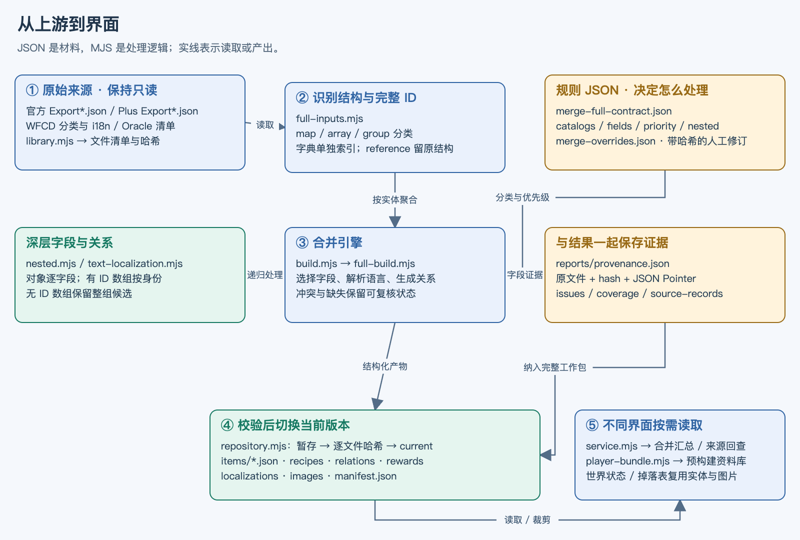
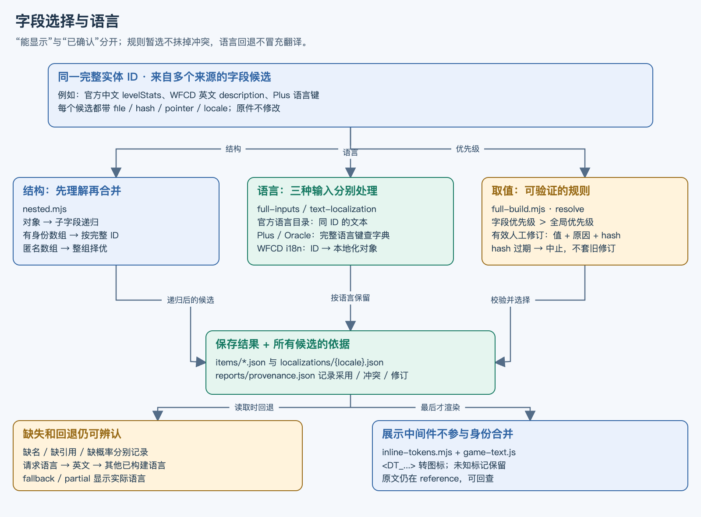
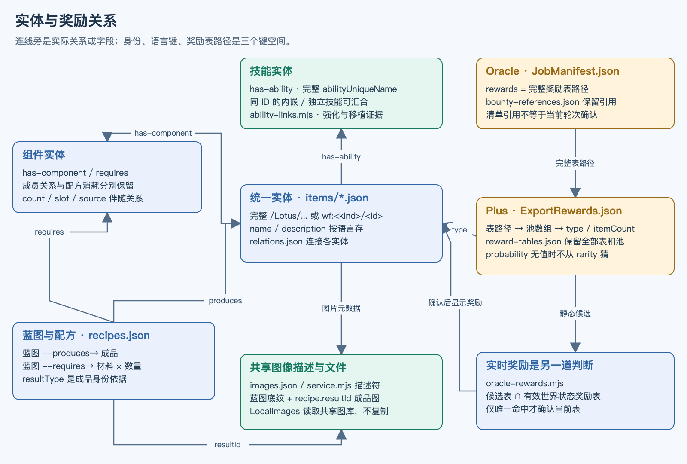

# P3 设计与代码图解

需要实际填写规则时，接着看 [合并合同逐项配置与编辑](39-合并合同逐项配置与编辑.md)：每个选项的作用、默认字段含义和程序内添加示例。

P3 是把多来源游戏资料整理成**统一身份、可追溯、可离线消费的数据层**。合并汇总、玩家资料库、世界状态奖励及掉落关联由此共享物品身份，不必各自重新理解所有原始 JSON。

核对日期：2026-10-27；依据当前工作区代码。这里的 P3 是原计划的跨来源静态合并阶段，已从 0.8.0 小样本发展为全量实现；不是九重天预测的阶段编号。下文描述已实现逻辑，历史数量不当作当前验收结果。

## 1 · 先看全貌



| 层 | 回答的问题 | 实际内容 |
| --- | --- | --- |
| 原始来源 | 上游到底提供了什么？ | 官方、Plus、WFCD、Oracle 文件；字典与其他参考结构分别识别 |
| 规则 JSON | 哪些记录是物品，字段该信谁？ | 分类、结构、字段类型、来源优先级、嵌套关系与路径别名 |
| 构建 MJS | 怎样把不同结构变成同一套数据？ | 完整 ID 聚合、递归处理、语言映射、配方与奖励关系 |
| 版本工作包 | 采用了什么，依据在哪里？ | 实体分片、关系、语言、溯源、问题报告与输入／输出哈希 |
| 消费界面 | 玩家与维护者分别看什么？ | 合并汇总看候选及证据；资料库看裁剪后的玩家信息 |

**关键思路：先确定身份，再选字段，最后做展示。** 名称相似、数组位置相同、图片长得相像，都不能证明两个对象是同一物品。

## 2 · 界面中的 P3 功能

| 入口／能力 | 使用者看到什么 | 核心实现 |
| --- | --- | --- |
| 合并规则 | 分类、字段、优先级、别名、人工修订；可导入导出 | `rules.mjs` + `src/ui/rules.js` |
| 构建全量资料 | 明确执行构建，显示进度；保存规则不会立即重写数据 | `build-merge.mjs` / `mergeBuild` → `MergeRepository.build` |
| 合并汇总 | 搜索、类型、语言、内部定义筛选及物品详情 | `service.mjs` + `src/ui/merge.js` |
| 字段来源 | 采用值、候选、冲突、修订及“查看原字段” | `reports/provenance.json` → `expandEvidence` |
| 关系导航 | 技能、组件、材料、产物、强化卡、灵化之源、套装成员互联 | `relations.json` + 对应关系适配器 |
| 奖励表 | 静态完整表、独立奖励池、清单上下文与物品卡片 | `reward-tables.json` + `reward-context.mjs` |
| 问题与构建差异 | 缺译、缺引用、字段差异，以及前后构建新增／移除／变化 | `issues.json` + `compareMerged` |
| 导出／内置资料库 | 导出完整工作包；玩家版另行预构建，打开时不用重新合并 | `exportMerged` / `createPlayerBundle` |

## 3 · JSON 结构怎样对应

三种“看起来都是路径”的键有不同用途，不能混为一个搜索词。

| 键空间 | 例子 | 用法 |
| --- | --- | --- |
| 实体 ID | `/Lotus/Powersuits/Volt/Abilities/ShockAbility` | 技能的稳定身份；跨语言不变 |
| 语言键 | 来源字段中的 `/Lotus/Language/...` | 在所选语言字典中精确查文本；不改实体 ID |
| 奖励表路径 | Oracle `rewards` 指向 Plus 表对象键 | 定位一张奖励表；不是奖励物品 ID |

### 各来源有自己的结构

| 来源 | 解析入口 | 如何关联 |
| --- | --- | --- |
| 官方 Public Export | `manifests/{语言}/Export*.json` 的 Export 分组数组 | `uniqueName`；技能为 `abilityUniqueName`，语言由目录明确识别 |
| Plus | `Export*.json` 常见“完整路径 → 记录”的对象 | 对象键作为身份；文本值若是完整语言键，查 `dict.{语言}.json` |
| WFCD | 分类 JSON 数组 + `i18n/{语言}.json` | 分类记录 `uniqueName`；i18n 是“物品 ID → 本地化对象”，不是扁平语言字典 |
| Oracle | `data/*JobManifest.json` 与 `dicts/{语言}.json` | 清单中的完整表路径与完整语言键分别解析 |

`full-inputs.mjs` 按合同的 `map / array / group / nested` 规则读取。没有参与实体建模的已识别资料仍可进入 `reference`；排除项和原因进入文件盘点。没有 `/` 开头的实体标识会转为 `wf:<类别>/<原标识>`，避免星图编号与其他类别碰撞。

### 嵌套不是“一整块任选一份”

- **对象**：按子字段递归，保留来源指针；未知字段仍进入属性／参考。
- **有完整身份的数组**：按 `uniqueName / abilityUniqueName / ItemType / itemId` 对齐，元素换顺序也不串物品；同一数组身份必须唯一。
- **无身份数组**：保留整组候选。攻击模式、等级数组不能仅凭相同下标跨源拼接。
- **技能／组件集合**：按专用规则提取子实体和关系；数量与槽位跟随正向集合，反向 parent 记录补证据。

## 4 · 字段、中文与多语言如何决定



| 决策 | 当前逻辑 |
| --- | --- |
| 候选排序 | 字段指定优先级优先；否则使用合同的全局顺序。内置为官方 → Plus → WFCD → Oracle |
| 类型／范围 | 不合规候选跳过并记问题；不让无效值挤掉有效候选 |
| 来源冲突 | 暂取规则优先值，同时保留候选并标 `conflict`；采用值不等于人工审核确认 |
| 人工修订 | 指定实体、已建模字段、值、原因与 `expectedSourceHash`；哈希过期直接拒绝构建 |
| 多语言 | name／description 各语言独立保存；深层字段写入 `localizations/{locale}.json` |
| 缺少描述 | 有可靠等级效果时派生满级摘要，标记 `max-rank-stats`；完整等级仍保留 |
| 读取回退 | 深层字段按请求语言 → 英文 → 其他已构建语言查找；标记实际语言、`fallback`／`partial` |
| 文本图标 | 最后由展示中间件处理 `<xxx>`；已知标记变图标，未知标记保留；原文可回查 |

**实例：带电子弹。** 中文效果在官方 `levelStats[].stats[]`，并非顶层 description；满级摘要可以来自最后一个有效等级。`<DT_ELECTRICITY_COLOR>` 是电击图标标记，不应当作乱码删除。构建负责保留等级和语言依据，界面中间件负责显示图标——两者分工不同。

默认合同构建中英；增加语言需要实际输入、字典与重新构建，不能只加一个前端选项。任意英文段落不会被机器猜译后写成“官方中文”。详见 [多语言映射](10-字段字典与多语言映射.md)。

## 5 · 技能、蓝图、奖励怎样串起来



### 配方关系与成员关系分别保存

蓝图的 `resultType` → 成品；`ingredients[].ItemType / ItemCount` → 材料及用量；费用、时间和产量分别读取明确字段。它们生成 `recipes.json` 及 `produces / requires` 关系。`components` 生成的 `has-component` 是成员关系，不重复计作另一份配方材料。

蓝图叠图也用同一条 `resultId` 关系：底纹在下、对应成品图在上。不会通过去掉 `Blueprint` 后缀猜成品。强化 Mod、移植技能、灵化之源、套装 Mod 另有适配器；Wiki Lua 只抽取明确元数据，不执行源码。

### 静态奖励链：保存“有哪些表”

`Oracle 清单 rewards` → `Plus ExportRewards.json[完整表路径]` → 池数组 → 奖励 `type` → 显式路径别名 → 统一实体 → 名称／图片。

- 只按规则转换奖励物品的 `/Lotus/StoreItems/` 前缀，奖励表路径不改。
- 保存全部静态表，不因本轮没有使用而删除；池下标不自动当作任务阶段或 A/B/C。
- P3 的有效概率是 0…1；0 保留为 0，未知为 null。稀有度不能推算概率，也不自行归一化。
- 现金／内融核心包在有明确每包数值时乘原数量，同时保留原 `itemCount` 和 conversion 依据。
- 缺少实体资料时建立 `unresolved` 引用并报告，不任意挑一个同名物品替代。

### 实时奖励链：判断“这次用哪张表”

Oracle 挑战任务可直接使用相应挑战档位的表。地区普通任务用静态难度候选表，与有效世界状态 `jobs[].rewards` 求唯一交集：唯一命中才确认当前轮次；单一静态表可标 fixed；其余保留候选和 unconfirmed。**seed 能参与任务推算，不能单独证明奖励轮次。** 这是 Oracle 业务层的判断，和 P3 全量保存分开。

## 6 · 产物怎么读，版本怎么保护

| 生成文件 | 作用／关联 |
| --- | --- |
| `manifest.json` | schema／modeling／mapping／builder 版本、输入与输出哈希、统计、quality、datasetVersion |
| `contract.json`、`overrides.json` | 复现本次采用的合同和人工修订 |
| `items/*.json` | 按 kind 分片的实体；关系目标用同一完整 ID |
| `recipes.json`、`relations.json` | 制作关系、成员关系、技能和其他关联 |
| `reward-tables.json`、`bounty-references.json` | 奖励表／池／物品，以及清单对表的引用 |
| `localizations/{locale}.json` | 各语言深层字段、选择来源、转换及字典证据 |
| `images.json`、`search.zh-CN.json` | 图像元数据与搜索索引；不含原图二进制 |
| `reports/provenance.json`、`reports/issues.json` | 逐字段候选、采用依据，以及缺失／冲突 |
| `reports/source-records.json`、`reports/coverage.json` | 源记录回查、文件处置、结构覆盖与已知局限 |
| `reference/<来源>/<hash>.json` | 按哈希保留源结构；未配置语言和未建模内容不会丢失 |

证据可紧凑保存为 `{input, pointer}`：input 指向 `manifest.inputs` 的零基下标，pointer 指向原 JSON 字段。`service.expandEvidence` 在读取详情时还原来源文件、哈希及位置，跳回原文件前继续检查内容身份。

仓库先写 staging，再核对每份输出字节的哈希，成功才更新 `current.json`；失败不替换当前版本。相同输入与规则可复现相同数据版本，成功切换后保留当前及上一构建。存在警告时 quality 可为 `review-required`，这不是“已审核线上包”。

**程序内置的是裁剪后的玩家快照。** `player-bundle.mjs` 从已校验 P3 工作包生成玩家所需索引，压缩为 `src/data/player-library/data.json.gz`；配套 manifest 校验大小、SHA-256 与数据版本。它保留玩家关系，省去完整源证据；原始资料和完整工作包仍用于维护。完整 P3 构建、内置快照和图片文件是三种不同产物。

## 7 · 代码导航：从哪里开始读

路径从项目根目录起算；行号为本次核对位置，后续改动可能移动。`.mjs` 执行业务逻辑，`.json` 声明规则或承载数据，`src/ui/*.js` 组织界面。

### 构建、规则与递归

| 文件位置 | 职责与关键输入／输出 |
| --- | --- |
| `scripts/build-merge.mjs:1` | CLI 入口；本地目录或快照 → 合同／修订 → 构建，可选导出 |
| `src/data/merge-full-contract.json:1` | 当前全量合同；schema 2、mapping `p3-full-2`；分类、字段、语言、关系 |
| `src/data/merge-overrides.json:1` | 内置人工修订；不等同桌面用户保存的个人规则 |
| `src/core/merge/rules.mjs:12`、`:56` | validateRules 校验；RuleStore 保存／上一版／revision 防覆盖 |
| `src/core/merge/build.mjs:12` | 按 scope.mode 分派全量或旧 pilot 小闭环 |
| `src/core/merge/full-inputs.mjs:7` | 按来源结构聚合 ID；构造字典、输入盘点与 reference |
| `src/core/merge/full-build.mjs:13` | 主流程；字段选择、关系／配方／奖励及报告；`:253` 起组装输出 |
| `src/core/merge/nested.mjs:21`、`:40` | indexNested 提取子实体；mergeNested 递归对象及有 ID 数组 |
| `src/core/text-localization.mjs:7`、`:41` | 精确字典键翻译；读取对应语言与明确回退 |
| `src/core/localized-text.mjs:3` | 由真实等级 stats 派生摘要；保留转换来源 |
| `src/core/merge/contract.mjs:6` | stable／digest／pointer 等确定性序列化和证据工具；FULL_MODELING_VERSION 在 `:3` |

### 关系、存储与界面消费

| 文件位置 | 职责与关键输入／输出 |
| --- | --- |
| `src/core/merge/ability-links.mjs:25` | 技能／武器强化、移植技能关系与明确元数据证据 |
| `src/core/merge/incarnon-links.mjs:6` | 武器家族与灵化之源适配关联 |
| `src/core/merge/mod-set-links.mjs:5` | 套装成员、套装名称／效果关系 |
| `src/core/merge/reward-context.mjs:12` | 原清单引用 → 奖励表的地区、任务与中文上下文 |
| `src/core/oracle-rewards.mjs:48` | 静态表与有效世界状态 → 当前奖励表确认／候选 |
| `src/core/merge/repository.mjs:10`、`:38` | 版本仓库及 build；校验、切换、差异与导出 |
| `src/core/merge/service.mjs:35`、`:107` | 展开证据；mergedDetail 将语言、图片、配方与关联组织为界面数据 |
| `src/ui/merge.js:196`、`src/ui/rules.js:3` | 合并详情与奖励卡片；规则编辑器 |
| `src/core/player-bundle.mjs:13`、`:23` | 裁剪工作包；校验并加载内置压缩快照 |
| `scripts/prepare-player-library.mjs:1` | 维护时预构建；`--check` 验证现有内置资料 |
| `src/core/player-library.mjs:81`、`src/core/player-acquisition.mjs:50` | 玩家筛选／详情投影；掉落与获取索引 |
| `src/core/local-images.mjs:1`、`src/ui/images.js:1` | 按明确身份读取共享图库并展示；不将图像文件复制到实体 JSON |
| `src/core/inline-tokens.mjs:4`、`src/ui/game-text.js:1` | `<xxx>` 文本标记在展示阶段转为语义与图标 |

## 8 · 当前边界与维护入口

对象能完整保留，不代表业务语义都已归一。复杂攻击模式、非标准氏族制作、未确认奖励阶段等仍需专用适配器；未知项保留，不能只补一条标量映射就声称完成。项目当前未部署 App／uniCloud／ECS 分发接口，也不会用 P3 静态数据伪装实时世界状态。

本次只新增说明与文档图示支持；未重新构建完整数据、修改合并规则或打包。图示为可维护代码产物：

```sh
node scripts/build-p3-guide-diagrams.mjs --write-vault
node_modules/.bin/electron scripts/render-project-diagrams.cjs 文档/图示/p3-manifest.json
```

SVG／PNG／Canvas 与清单位于 `文档/图示/P3-*`、`文档/图示/p3-manifest.json`；`--write-vault` 同步三份 Canvas 到当前 Obsidian 库的项目目录。编辑时应先核对代码关系，再改生成脚本；不要只手改导出的 PNG。

继续阅读：[P3 规则与奖励细节](03-P3合并规则与奖励关系.md)、[多语言映射](10-字段字典与多语言映射.md)、[玩家资料库](20-玩家资料库.md)、[共享图库维护](33-Wiki图库增量维护与交易校验.md)。
