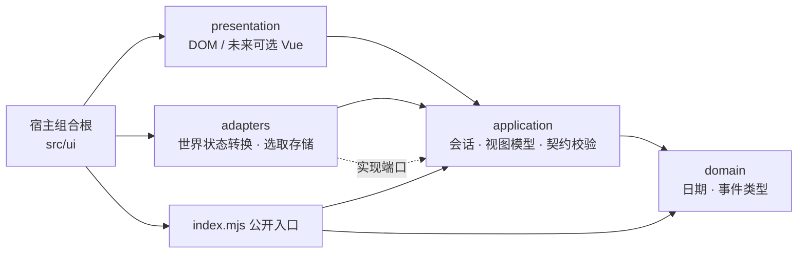

# 41 · 1999 日历架构决策与公开契约（CAL-01）

对应 Issue [#12 CAL-01：确立架构决策与公开契约](https://github.com/Dreamsunqing/1020-pbex-wfcd-zlk/issues/12)，依据 Issue [#11 1999 日历功能模组化与 CI 开发计划](https://github.com/Dreamsunqing/1020-pbex-wfcd-zlk/issues/11)。

本文件只定义架构与契约，不包含世界状态适配器、选取会话、DOM 界面或 CI 检查；这些属于 Issue #11 后续的 issue。日期、季度与事件的领域规则（CAL-02）见 [42 · 1999 日历领域规则](42-1999日历领域规则.md)。

## 一、范围与参考

- 代码位于 `src/features/calendar-1999/`，测试位于 `test/calendar/`。
- 分支 `arch/12-contracts-and-adr`，从 `main` 建立。
- 原生 DOM 为界面技术（见 [ADR-003](#adr-003)）。

既有实现给本次契约带来的修正：

| 既有做法 | 本次契约 |
|---|---|
| `read()` 每次都写入选取存储 | `read()` 为纯函数，只有修改操作才写入（[ADR-005](#adr-005)） |
| 界面层自行组装日期格与选取内容 | 应用层提供纯函数 `BuildCalendarViewModel`，界面只负责绘制（[ADR-008](#adr-008)） |
| 日期计算使用 `Date.now()` 或隐式时间 | 时间由调用方以 `now` 注入（[ADR-004](#adr-004)） |
| 类型用字符串散落在各层 | 类型词汇集中在 `domain/event-kind.mjs`（[ADR-005](#adr-005)） |
| 没有卸载流程 | 定义挂载、更新与释放，重复挂载会先释放旧句柄（[ADR-007](#adr-007)） |

## 二、架构决策记录（ADR）

每条 ADR 的标题只写编号，作为固定锚点（例如 `#adr-001`），主题写在标题下方。修改主题不会使链接失效；文中引用 ADR 时一律链接到对应锚点。

### ADR-001

**功能模块 + 轻量端口与适配器**

采用 Feature Module 与 Hexagonal Architecture 的轻量形式。核心规则不依赖 Electron、DOM、网络或文件系统；世界状态结构由适配器转换；平台能力由宿主注入。

理由：功能需要能在无 App、无图库、无网络的环境下独立运行与测试，因此必须把宿主依赖隔离到端口后面。

### ADR-002

**契约的描述方式：JSDoc typedef + 运行时校验**

- 契约写成 `application/ports.mjs` 中的 JSDoc typedef，并由 `application/contract-validation.mjs` 在运行时检查数据。
- 不引入 TypeScript 构建步骤。

理由：项目是原生 ES Modules，直接由 Electron 加载，没有打包流程。引入 TypeScript 会新增编译链路，而 CAL-01 的验收只需要可读的契约与可执行的数据范例。运行时校验比类型声明更能捕获来自世界状态或存储的脏数据。

### ADR-003

**界面技术：原生 DOM，Vue 属于界面层**

- 界面层使用原生 DOM，与现行实现一致，无需构建步骤，可直接用浏览器测试。
- Vue 若日后需要，只能作为 `presentation/` 的一种实现替换，不得进入 domain、application 或 adapters。

对应 Issue #7 中关于「要不要用 Vue」的讨论与 Issue #12 的验收条件。

### ADR-004

**日期与时间**

- `day` 是 1999 年全年、从 1 开始的日序，不是季度内序号，也不是数组索引。
- 日期与星期按 UTC 计算。固定为非闰年，`yearIteration` 只识别轮回。
- 核心代码不读取环境时钟。需要「现在」的地方（例如倒计时）由调用方以 epoch 毫秒传入 `formatDeadline(startsAt, endsAt, now)`。
- 契约中的时间字段（`startsAt`、`endsAt`、`sourceTime`）只接受实际存在的 UTC 时间，格式为 `YYYY-MM-DDTHH:mm:ssZ` 或 `YYYY-MM-DDTHH:mm:ss.sssZ`。以下都无效：时区偏移（`+08:00`）、只有日期（`2026-10-29`）、任意文字（`123`、`Oct 29 2026`），以及会进位的日期（`2026-02-30`、`T24:00:00`）。
- 这些时间是现实世界的时间，与 1999 日序无关；例如 `2028-02-29T00:00:00Z` 有效。

> 依据：[WFCD Calendar.ts getDate](https://github.com/WFCD/warframe-worldstate-parser/blob/master/lib/models/Calendar.ts)，以及 [DE Update 38](https://www.warframe.com/en/patch-notes/pc/38-0-0) 的季度说明。

### ADR-005

**选取状态与类型词汇**

- `SelectionStore` 由宿主持有。键 `contextId` 对功能不透明，值在读写时复制。
- `contextId` 必须在服务器、季度代码、`yearIteration` 或 `startsAt` 变化时改变；不因快照的新旧（`kind`、`stale`）而改变，以保留同一季度的选取（跨快照恢复见 [ADR-007](#adr-007)）。
- 存储中读回的值视为不可信，必须先经 `validateSelectionValue`，无效时回退默认值。
- 事件类型只允许 `challenge`、`reward`、`upgrade`、`mixed`、`other`。显示文字属于界面层，核心不保存标签。
- `upgrade` 的显示名称统一为「煞调变」，三选一的说明写作「煞调变 · 三选一」。宿主现有的 `src/core/live-state/card-states.mjs` 仍标为「强化日 · 三选一」，接入宿主时再统一。

### ADR-006

**未映射数据与证据保留**

- 超出全年范围（如 366）或缺少日序（`null`）的事件合法，并进入 `unmapped`，不得丢弃。
- `evidence` 为必填对象，保留原始引用，核心不解释它。
- 奖励必须带完整物品 ID。`libraryId` 为 `null` 时界面不显示跳转。
- 空的 `listedDays` 日不推定为生日，也不伪造事件。

### ADR-007

**生命周期**

执行步骤见第四节的[生命周期](#生命周期)。

- `mount(container, deps)` 返回 `CalendarViewHandle`。
- 对同一个容器重复挂载时，工厂先释放已有句柄。
- `destroy()` 可重复调用。释放后调用 `update()` 为空操作。
- `update()` 只依目前会话重绘，不读取新数据，也不改变选取。用于主题切换、倒计时刷新等不涉及新快照的情况。
- 会话只在建立时读取一次 `CalendarSource`。新快照到达时，宿主建立新的来源与会话，再重新挂载；不为会话新增刷新方法。
- 选取跨快照延续由 `SelectionStore` 负责：相同 `contextId` 恢复先前选取，不同 `contextId` 使用隔离状态。

理由：来源是固定快照，若让 `update()` 承担数据刷新，就必须另外定义会话如何替换来源、如何处理选取失效。重建会话可以重用既有的建立与恢复流程，不需要第二条数据路径。

### ADR-008

**界面模型的产生方式**

- 应用层提供纯函数 `BuildCalendarViewModel(state): CalendarViewModel`，预定位于 `application/view-model.mjs`。
- 界面层从 `session.read()` 或操作的返回值取得 `CalendarState`，再交给该函数取得模型。界面层不自行推导日期格、选取内容或未映射事件。
- 会话不提供 `readViewModel()`。

理由：会话负责状态与操作，模型函数负责转换，两者可以分别测试。原生 DOM 与日后可能的 Vue 界面共用同一个函数，不会各自决定数据流。CAL-01 只定义此接口，实现留给应用层的后续 issue。

## 三、依赖方向

规则（来自 Issue #11，并由 CAL-01 确认）：

| 层级 | 责任 | 禁止依赖 |
|---|---|---|
| domain | 日期、季度、事件类型、数据不变条件 | 任何外层、DOM、Electron、网络、存储、环境时钟 |
| application | 会话操作、视图模型、契约定义与校验 | 具体界面、具体适配器、平台 API |
| adapters | 世界状态转换、选取存储实现 | 界面细节、其他功能的内部模块 |
| presentation | 绘制、键盘与焦点、无障碍属性 | 直接读取原始世界状态、直接访问平台 |
| 组合根（宿主） | 组装依赖、注入能力 | 业务规则 |

其他功能只能经由 `index.mjs` 使用本功能。不允许循环依赖。

## 四、契约清单

所有契约定义在 `src/features/calendar-1999/application/ports.mjs`。

契约版本为 1.1.0：CAL-04 新增可选的 `RewardRef.libraryVersion`、`TermRef.key` 与 `TermRef.source`，1.0.0 文档仍然有效。原因与世界状态的字段对应见 [43 · 1999 日历世界状态转接器](43-1999日历世界状态转接器.md)。

| 契约 | 内容 | 同步性 |
|---|---|---|
| `CalendarSource` | `read(): CalendarDocument`，纯函数，返回已加载快照 | 同步 |
| `CalendarDocument` | `contextId`、`data`（服务器、来源类型、过期标记、来源时间）、`seasons[]` | — |
| `CalendarSeason` | 代码、名称、轮回、起止时间、`listedDays`、`entries[]` | — |
| `CalendarEntry` | 日序、类型、标题、奖励、条款、证据 | — |
| `SelectionStore` | `read(contextId)`、`write(contextId, value)` | 同步 |
| `CalendarSessionFactory` | 以 `{source, selectionStore}` 建立会话，读取来源一次并恢复选取 | 同步 |
| `CalendarOperations` | `read`、`selectSeason`、`selectMonth`、`selectDay`、`move` | 同步 |
| `CalendarState` | 季度、月份（`CalendarMonth`）、日期（`CalendarDay`）、选中日、未映射事件、选取值 | — |
| `CalendarViewModel` | 季度选项、当前季度起止、月份标签、42 格网格、选中日、未映射事件、状态 | — |
| `BuildCalendarViewModel` | `CalendarState → CalendarViewModel` 的纯函数 | 同步 |
| `CalendarCapabilities` | `close`、`openItem`、`loadArt`、`renderText`、`formatDeadline` | 见下 |
| `CalendarViewFactory` / `CalendarViewHandle` | 挂载、更新、释放（[ADR-007](#adr-007)） | 同步 |

### 操作接口

| 操作 | 输入 | 行为 | 失败方式 |
|---|---|---|---|
| `read()` | — | 返回 `CalendarState`，不写存储 | 不失败 |
| `selectSeason(index)` | 季度索引 | 切换季度，月份重置为第一个月，日期清空 | 索引越界抛 `RangeError` |
| `selectMonth(index)` | 月份索引（0–2） | 切换月份，日期清空 | 越界抛 `RangeError` |
| `selectDay(ordinal)` | 全年日序 | 选择当前月内的日期 | 不在当前月抛 `RangeError` |
| `move(key)` | `ArrowLeft/Right/Up/Down/Home/End` | 移动选中日，可在本季三个月之间跨月，成功返回 `true` | 目标不在本季或按键未知返回 `false`，不抛错 |

修改操作在返回前写入 `SelectionStore`。无效输入不静默截断。初始选取、恢复回退、重复选择与键盘细节由 CAL-03 决定，见 [44 · 应用操作流程](44-1999日历应用操作流程.md)。

### 外部能力

| 能力 | 参数 | 返回 | 失败处理 |
|---|---|---|---|
| `close()` | — | `void` | 不抛错 |
| `openItem(ref)` | `RewardRef` | `boolean`，`false` 表示目标不可用 | 不抛错，界面保留当前状态 |
| `loadArt(ref)` | `{libraryId, iconToken?}` | `Promise<{status:'found', src} \| {status:'missing'}>` | 不 reject，任何失败映射为 `missing` |
| `renderText(target, text, mode)` | 目标元素、原文、`'name'` 或 `'description'` | `void` | 未知标记保留原文可见 |
| `formatDeadline(startsAt, endsAt, now)` | UTC 时间与 epoch 毫秒 | `{text, ended}` | 时间无效时 `text` 为空字符串 |

### 生命周期

规则与理由见 [ADR-007](#adr-007)。

1. **建立**：宿主持有 `SelectionStore`，创建 `CalendarSource`，再以两者创建会话。会话读取来源一次，并按 `contextId` 恢复选取；存储值无效时回退默认值。
2. **挂载**：宿主调用工厂 `mount(container, {session, capabilities})`，得到句柄。界面以 `BuildCalendarViewModel` 取得模型后绘制。
3. **更新**：同一会话需要重绘时调用 `update()`，不读取新数据，不改变选取。
4. **新快照**：宿主建立新的来源与会话，再挂载到同一容器。工厂先释放旧句柄；相同 `contextId` 从存储恢复选取，不同 `contextId` 使用隔离状态。
5. **释放**：离开页面时调用 `destroy()`，可重复调用。

## 五、数据范例

范例位于 `test/calendar/fixtures/contracts/`，由 `test/calendar/contracts.test.mjs` 验证。

| 文件 | 结果 | 说明 |
|---|---|---|
| `valid-document.json` | 有效 | 春季样本，含挑战、奖励与煞调变三选一 |
| `valid-unmapped-entry.json` | 有效 | 超出全年范围的日序与 `null` 日序，必须保留为未映射 |
| `invalid-server.json` | 无效 | 服务器不是 `de` 或 `wg`（`UNKNOWN_SERVER`） |
| `invalid-entry.json` | 无效 | 未知事件类型、奖励缺少完整 ID、缺少证据（`UNKNOWN_KIND`、`INVALID_REWARD`、`MISSING_EVIDENCE`） |
| `invalid-season-window.json` | 无效 | 结束时间早于开始时间、`listedDays` 重复或超出范围（`INVALID_WINDOW`、`DUPLICATE_LISTED_DAY`、`INVALID_LISTED_DAY`） |
| `invalid-source.json` | 无效 | 来源类型、过期标记与来源时间都不合法 |

选取值的范例见 `contracts.test.mjs` 内的用例：`ordinal` 为字符串或 366、`monthIndex` 为 3 等均无效。

时间格式的有效与无效范例也在 `contracts.test.mjs` 中，同时检查 `sourceTime` 与季度的 `startsAt`。

## 六、验收对照（Issue #12）

| 验收条件 | 证明 |
|---|---|
| 不阅读具体 UI，就能理解日历操作接口 | 本文第四节「操作接口」与 `ports.mjs` |
| 不阅读世界状态原始结构，就能建立测试数据源 | `valid-document.json` 只依赖 `CalendarDocument` 契约，不含世界状态字段 |
| 有至少一组有效及无效数据范例 | 第五节，共 2 组有效、4 组无效 |
| 有依赖方向图 | 第三节 |

Vue 属于界面层的说明保留在 [ADR-003](#adr-003)，但它已不在 Issue #12 的验收条件中（Issue 于 2026-10-29 更新）。

契约定义部分的自动化测试：`node --test test/calendar/contracts.test.mjs`。

## 七、未决问题

以下事项不属于 CAL-01 的决定，留待对应 issue 处理：

1. **文案语言**：既有界面文字为繁体，项目其他部分为简体。需要统一。
2. **跨月键盘导航**：已由 CAL-03 决定。方向键可在当前季度的三个月之间跨月，不跨季度；Home／End 限在当前月内，见 [44 · 键盘行为](44-1999日历应用操作流程.md#五键盘行为)。
3. **会话是否需要同步快照**：`CalendarSource.read()` 目前为同步，会话只在建立时读取一次（[ADR-007](#adr-007)）。若日后要支持异步加载，需要新增 ADR。
