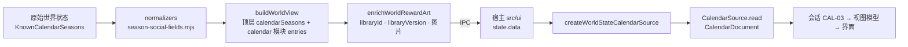

# 43 · 1999 日历世界状态转接器（CAL-04）

对应 Issue [#16 CAL-04：建立世界状态数据转接器](https://github.com/Dreamsunqing/1020-pbex-wfcd-zlk/issues/16)，依据 Issue [#11 1999 日历功能模组化与 CI 开发计划](https://github.com/Dreamsunqing/1020-pbex-wfcd-zlk/issues/11)。契约与 ADR 见 [41 · 1999 日历架构决策与公开契约](41-1999日历架构决策与契约.md)。

本文件只描述世界状态到 `CalendarDocument` 的转换。会话（CAL-03）、选取存储（CAL-05）与界面接入属于其他 issue；现有世界状态页面仍使用原来的日历卡片，行为不变。

## 一、范围

| 内容 | 位置 |
|---|---|
| 转接器 | `src/features/calendar-1999/adapters/world-state-source.mjs`，经 `index.mjs` 公开 `createWorldStateCalendarSource` |
| 宿主投影补充 | `src/core/live-state/view.mjs` 的 `buildWorldView` 结果新增顶层 `calendarSeasons`（CAL-04 原放在 `calendar` 模块选项上，#28 的 CORE-02 移到顶层，原因见第六节） |
| 契约 1.1.0 | `application/ports.mjs`、`application/contract-validation.mjs`（新增三个可选字段，见第六节） |
| 契约测试 | `test/calendar/adapters.test.mjs`，夹具 `test/calendar/fixtures/world-state/projection-de.json` |

## 二、数据流



转接器是功能内唯一认识世界状态投影的模块。domain、application、presentation 只看到 `CalendarDocument`，不读取 `modules`、`cardState`、`reference` 等宿主字段；`evidence` 原样保留但功能不解释它（[ADR-006](41-1999日历架构决策与契约.md#adr-006)）。

## 三、转换入口

```js
import { createWorldStateCalendarSource } from '../features/calendar-1999/index.mjs';

// 一份投影只属于一个服务器；国际服与国服各建一个来源。
const source = createWorldStateCalendarSource(state.data);
const document = source.read();
```

- 输入：`buildWorldView` 的结果，可已经过 `enrichWorldRewardArt`。转接器只读取 `server`、`kind`、`stale`、`sourceTime`、顶层 `calendarSeasons` 与 `modules` 中 `id === 'calendar'` 的模块（只取其 `entries`）。
- 输出：冻结的 `CalendarSource`。文档在建立时生成并校验一次，之后每次 `read()` 返回新的深拷贝。
- 失败：投影不是对象、没有 `modules` 数组、有条目没有任何事件（`INVALID_EVENTS`，第五节第 10 条），或结果无法通过 `validateCalendarDocument` 时抛出 `TypeError`；`error.issues` 列出全部问题（路径与代码）。宿主可据此回退到旧卡片。

## 四、字段对应

| 契约字段 | 投影来源 | 规则 |
|---|---|---|
| `contextId` | `server` 与每个季度的代码、轮回、开始时间 | JSON 数组字符串；不含 `kind`、`stale`（[ADR-005](41-1999日历架构决策与契约.md#adr-005)） |
| `data.server` | `server` | 只接受 `de`、`wg` |
| `data.kind` | `kind` | `sample`、`network`、`import` |
| `data.stale` | `stale` | 原样保留，离线样本不会变成当前排期 |
| `data.sourceTime` | `sourceTime` | 必须是 UTC 时间 |
| `season.code` | `view.calendarSeasons[].season` | 未知代码保留，由 domain 归入未映射 |
| `season.label` | `view.calendarSeasons[].label` | 宿主已本地化的中文季节名 |
| `season.yearIteration` | `view.calendarSeasons[].yearIteration` | 只识别轮回，不转换为年份，不强制转型 |
| `season.startsAt`／`endsAt` | `view.calendarSeasons[].startsAt`／`endsAt` | 原样 |
| `season.listedDays` | `view.calendarSeasons[].listedDays` | 去重；用 domain 的 `isAnnualDay` 只保留 1–365 的整数 |
| `entry.ordinal` | `entries[].reference.day` | 整数原样（含超出范围）；其他值为 `null` |
| `entry.kind` | `entries[].reference.events[].type` | 逐个事件映射为 `EventKind`，再由 CAL-02 的 `classifyDay()` 汇总；不读 `cardState`。映射表与异常处理见第五节第 9、10 条 |
| `entry.title` | `entries[].title` | 宿主的「游戏日 N」 |
| `reward.id` | `rewards[].id` | 目录给出的完整 ID，原样保留 |
| `reward.name` | `rewards[].name` | 中文名称（`reward-art` 补全后） |
| `reward.quantity` | `rewards[].quantity` | 非负整数，否则 `null` |
| `reward.libraryId` | `rewards[].libraryId` | 没有资料库对应时为 `null`，界面不显示跳转 |
| `reward.libraryVersion` | `rewards[].libraryVersion` | 没有时为 `null` |
| `term.name` | `terms[].name` | 为空时显示上游键原文，不编造名称 |
| `term.description` | `terms[].description` | 只有字符串时才出现 |
| `term.key` | `terms[].key` | 挑战或强化的上游键 |
| `term.source` | `terms[].source` | 中文来源，例如 `wfcd-calendar-project-translation`；未知为 `null` |
| `entry.evidence` | `entries[].reference` 的深拷贝 | 季节、轮回、日序、原始事件、本地化与强化前置条件 |

一个投影条目对应一个 `CalendarEntry`，即一天的全部事件：奖励日的两项候选奖励、强化日的三个选项都在同一条目内。

## 五、规则与边界

1. **季度身份**：季度以（代码、轮回、开始时间）识别。条目按 `reference.season`、`reference.yearIteration` 与条目的 `startsAt` 归入季度。
2. **不归属任何季度的条目**：以条目自身的字段建立独立季度，`listedDays` 为这些条目的日序。不会丢弃，也不会并入其他季度或轮回。没有 `calendarSeasons` 的旧投影也按此规则从条目推出季度。
3. **没有事件的上游日**：只出现在 `listedDays`，不生成条目，不推定为生日。DE 样本的 1、45、74 日即属此类。
4. **未知与未映射**：未知事件类型为 `other`（映射见第 9 条）；日序 400、缺失或非整数的日序都保留，由 domain 放入 `unmapped`。
5. **同日多条目**：同一天的重复或混合条目全部保留，顺序与投影一致；`listedDays` 不重复。
6. **物品身份**：只使用投影中的完整 ID。名称相同的两个奖励保留各自 ID；缺少 ID 的奖励使建立失败，不按名称或位置补 ID。`id` 与 `libraryId` 来源不同：前者来自世界状态目录，后者由 `reward-art.mjs` 在资料库中解析。真实数据中两者通常相同（DE 样本 12／12），缺少商店别名时 `id` 会保留上游商店路径，二者从不互相推导。
7. **不修改来源**：投影在转换前后完全相同；`read()` 返回的对象可随意修改，不影响下一次读取；建立来源后再修改投影也不影响来源。
8. **双服与季度隔离**：服务器、轮回、季节代码或开始时间任一不同，`contextId` 就不同。相同季度的新网络快照保持相同 `contextId`，选取可以延续；`stale` 与 `kind` 照实反映。
9. **事件映射由转接器持有（CORE-01）**：`entry.kind` 只由 `reference.events` 的来源事件决定，不读宿主旧卡片的 `cardState`。映射表是转接器内唯一的一份（[42 · 第六节](42-1999日历领域规则.md#六留给后续-issue) 的移交已完成）：

   | 来源事件 `type` | `EventKind` |
   |---|---|
   | `CET_CHALLENGE` | `challenge` |
   | `CET_REWARD` | `reward` |
   | `CET_UPGRADE` | `upgrade` |
   | `CET_PLOT`（上游的生日事件）、其他未知类型、缺少 `type`、不是对象的事件、`constructor` 等继承名称 | `other` |

   一天的所有事件映射后交给 CAL-02 的 `classifyDay()`：种类相同（含重复）为该种类，两种以上不同种类为 `mixed`。因此混合以映射后的领域类型计算，与旧卡片按原始类型计算不同：`CET_PLOT + CET_FUTURE` 旧卡片是 `mixed`，现在两者都是 `other`，所以是 `other`；`CET_CHALLENGE + CET_PLOT` 是 `mixed`。词汇表不新增生日类型；对话与其余原始字段都在 `evidence` 中，domain 不解释。
10. **没有事件的条目一律拒绝（CORE-01）**：投影条目代表「有事件的一天」。宿主只投影有事件的日子，没有事件的上游日只在 `listedDays`（第 3 条）。所以条目的 `reference.events` 缺失、不是数组或为空，与这个前提矛盾：这一天没有任何事件可分类。若把 `classifyDay([])` 的 `null` 当成 `other`，会凭空造出一个事件，使当月 `eventDays` 加一，并让这一天成为初始选取日（审查实测过）。转接器因此拒绝整份投影：抛出 `TypeError`，`error.issues` 含 `INVALID_EVENTS`，路径指向该条目（例如 `modules.calendar.entries[2].reference.events`），不建立条目，也不退回 `cardState`。保留「无事件」语义的另一条路是把空事件条目直接变回只列出的日子，但那会无声丢掉条目上的标题、奖励与条款，所以不采用。数组里有事件但读不懂（`null`、数字、没有 `type`）时，它们是类型未知的事件，按 `other` 计入：`CET_REWARD` 加一个读不懂的事件得到 `mixed`，只有读不懂的事件得到 `other`，都不会静默当作某一种已知类型。
11. **无法归属季度的条目**：条目没有 `reference`，或缺少 `reference.season`／`reference.yearIteration`，就无法放进任何季度；猜一个季度会把不同轮回混在一起。此时整份转换以 `TypeError` 失败，`error.issues` 含 `INVALID_SEASON`，宿主可回退到旧卡片。这是明确的失败，不是默认值，也不丢弃该条目。
12. **全年日序只有一份规则（CORE-03）**：`listedDays` 用 domain 的 `isAnnualDay` 过滤，转接器不再自带 `DAYS_IN_1999` 或另一份判断。越界日序的事件仍以条目保留，只有无法显示成日期的 `listedDays` 被滤掉。测试同时检查边界值与转接器源码没有自己的规则。

## 六、为何补充宿主投影与契约

**宿主投影**：原 `calendar` 模块的 `entries` 只包含有事件的日子（`filter(day=>day.events?.length)`），无法得知上游列出但事件为空的日子，也无法得知季度窗口本身。新增的 `calendarSeasons` 内容为每个当期季度的代码、中文名、轮回、起止时间与全部上游日序，现有界面不读取此字段。

CAL-04 最初把它放在 `calendar` 模块的选项上。整季都没有事件时，`buildWorldView` 末尾的空模块过滤会把整个模块移除，季度资料跟着消失（CORE-02）。模块是否显示是旧页面的卡片决定，季度是否存在是资料问题，两者不能绑在一起，所以 `calendarSeasons` 改为 `buildWorldView` 结果的顶层字段，`modules`、`summary` 与旧页面的分页计数、统计、卡片显示都不变（`enrichWorldRewardArt` 原地补图并返回同一个视图，顶层字段原样保留）。不选「让空的日历模块留在 `modules` 里」，因为它会多出一张空卡片，并改变每周分组的计数与统计。

**契约 1.1.0**（均为可选，1.0.0 文档仍然有效；字段存在时由 `validateCalendarDocument` 检查）：

| 字段 | 原因 |
|---|---|
| `RewardRef.libraryVersion` | `player-library.js` 的 `openFromWorld(id, version)` 会在资料版本变化时拒绝跳转；只保留 `libraryId` 会失去这个保护 |
| `TermRef.key` | 保留挑战与强化的上游键，便于追溯与排错 |
| `TermRef.source` | 强化中文为社区资料整理，界面需要能标示来源 |

## 七、验收对照（Issue #16）

| 项目 | 证明（`test/calendar/adapters.test.mjs`） |
|---|---|
| 定义转换入口 | `createWorldStateCalendarSource`，经 `index.mjs` 公开；`contracts.test.mjs` 检查公开入口 |
| 对应季度与起讫时间、全年日序 | a projection becomes a valid document… |
| 对应挑战、奖励及强化 | a projection becomes a valid document…；Chinese text, upstream keys… |
| 保留物品完整 ID、资料库导航信息 | rewards keep the full upstream ID next to the library link… |
| 保留中文及来源证据 | Chinese text, upstream keys and translation sources are kept… |
| 处理可选字段缺失 | missing optional values stay missing… |
| 保留未知与未映射事件 | unknown kinds, out-of-range days…；same-day, duplicate and mixed entries…；an entry outside every listed season… |
| Domain 与 Presentation 不需要原始字段 | the document carries contract fields only… |
| 转换不修改来源数据 | the projection is never mutated… |
| 不以名称猜测物品身份 | names never identify an item… |
| 不将缺失值改成假事件 | missing optional values stay missing…（无事件的日子只在 `listedDays`） |
| 双服及不同季度不混用 | servers, loops and season windows get isolated contexts… |
| 小型数据测试，不需完整上游目录 | 夹具为裁剪后的投影；最后一个测试只用 `weekly-semantics.json` 跑真实投影 |

Issue #28 补正的边界（CORE-01～03）另有以下证明，同样在 `test/calendar/adapters.test.mjs`：

| 项目 | 证明 |
|---|---|
| 事件类型由来源事件映射，不读 `cardState` | kind comes from the source events through the CET mapping, and the card state never decides（三种映射、`CET_PLOT`、未知与继承名称、重复、混合、两种未知类型，以及错误、缺失、非对象的 `cardState`） |
| 读不懂的事件是类型未知的事件 | events that cannot be read stay events of an unknown type…（六种形态保留为 `other`；没有事件的日子不产生条目） |
| 没有事件的条目被拒绝，不变成 `other` 事件 | an entry without any event is an inconsistent projection and is refused…（缺失、`null`、空数组、对象、字符串、数字；问题路径指向出错条目；经会话确认没有事件的第 1 日不会成为事件日或初始选取日） |
| 无法归属季度的条目 | an entry that names no season fails the whole conversion… |
| 日序判断共用 domain | listed days follow the domain annual-day rule…（边界值、越界事件、源码没有自带规则） |
| 整季无事件保留季度，且旧页面不变 | `de`／`wg`: a season whose days have no events keeps its window…（从原始小型资料经 `buildWorldView()`；卡片仍隐藏，每周分组计数与统计不变） |
| 真的没有季度与季度没有事件可区分 | `de`／`wg`: no current season is different from a current season without days or events；both servers keep their own context… |

执行：`node --test test/calendar/*.test.mjs`。

## 八、已知限制与后续

1. **没有任何事件的季度**：已在 #28 修正（CORE-02）。宿主仍隐藏没有条目的卡片，但季度窗口与列出的日期由顶层 `calendarSeasons` 保留，转接器输出 `entries` 为空的季度；真的没有当期季度时才是 `seasons: []`。不再有「0 个季度」的歧义。
2. **1–365 以外且没有事件的上游日**：无法放到 1999 日期上，不进入 `listedDays`；有事件者以未映射条目保留。
3. **混合日**：保留为一个 `mixed` 条目（由来源事件映射后的种类计算，见第五节第 9 条，不再与宿主 `cardState` 绑定），奖励与条款都在其中，但条款不带自身类型。若界面需要逐项标示「挑战」或「煞调变」，需再扩充 `TermRef`。
4. **奖励图片**：`RewardRef` 不携带 `icon`、`imageName`；按契约，界面通过 `loadArt({libraryId})` 取图。`reward-art.mjs` 只在找到资料库物品时同时写入 `imageId` 与 `libraryId`，因此 `libraryId` 为 `null` 的奖励在新界面没有图片。2026-11-06 CAL-10 更新：画面改以 `loadArt({id, libraryId})` 请求，宿主先查奖励图片映射，无资料库项目的奖励也能有图，见 [50](50-1999日历奖励图片映射.md)。
5. **宿主尚未接入**：`src/ui` 还没有调用转接器，属于后续界面整合 issue。
6. **分支基准**：2026-10-31，`refactor/16-calendar-world-state-adapter` 已快转到开发整合分支 `origin/refactor/11-calendar-1999-ui-mvp` 的 `ae92eca`，包含 CAL-01（PR #19）与 CAL-02（PR #20）。恢复 CAL-04 未提交改动时，两处文档冲突已保留双方新增内容；`contract-validation.mjs` 保留 CAL-02 的 `isAnnualDay` 导入及 CAL-04 的可选字段校验。后续 PR 以 `refactor/11-calendar-1999-ui-mvp` 为目标分支。

## 九、审查待办与验收条件

> **版本说明**：本节保留 2026-11-01 CAL-05 复核时（整合分支 `c40ece5`）的记录，其中「尚未修复」「待修正」「下一 issue」都指当时状态。下一 issue 就是 [#28](https://github.com/Dreamsunqing/1020-pbex-wfcd-zlk/issues/28)，CORE-01～04 已在分支 `fix/28-calendar-core-gaps` 修正；各项最新状态与正式决定以 [46 · 核心阶段完成度查核](46-1999日历核心阶段完成度查核.md) 为准。分支合并前，这些修正还没有进入整合分支。

2026-10-31 原始复核记录：当时以下三项尚未修复，第七节的测试对照只说明已有覆盖，不代表这些边界已通过验收。当时 35 项日历测试与 38 项相关世界状态测试通过，也不能替代下列回归测试；原审查建议在关闭 Issue #16 前逐项修正。Issue 后续状态与本轮移交安排以下一段为准。

2026-11-01 CAL-05 复核补充：Issue #16 已关闭，但三项仍未修复。第 1 项（`CET_CHALLENGE` 搭配 `cardState.id = reward` 输出 `reward`）与第 3 项（DE、WG 整季无事件都输出 0 个季度）再次重现。开发者计划在下一 issue 统一整理，建议的承接范围见 [45 · 第十一节第 4 项](45-1999日历选取存储转接器.md#4-后续-issue-规划建议尚未建立)；表中 CAL 编号尚未分配，不能当作已有 open issue。这三项可以后续修正，应在新 UI 整合验收前完成，不要求并入当前 CAL-05。若后续决定新增逐季历史记忆，稳定季度键应与来源识别、会话恢复契约一起规划，本轮不为此扩张 #17。

2026-11-01 Issue [#28](https://github.com/Dreamsunqing/1020-pbex-wfcd-zlk/issues/28) 承接：以下三项（CORE-01、CORE-03、CORE-02）已在分支 `fix/28-calendar-core-gaps` 修正，勾选与测试对照以第五、七节为准。下面各项保留当时的复现与验收条件，「修正前」「当前实现」均指修正前。这只是 #16 的遗留缺口已补，不表示整个核心阶段或 #11 已完成；画面与宿主接入仍待后续阶段。

### 1. CAL-04 明确持有事件映射规则

- [x] 根据投影的 `reference.events` 将 `CET_*` 映射为 `EventKind`，再交给 CAL-02 的 `classifyDay()` 汇总；不再以旧卡片的 `cardState.id` 决定领域类型。

修正前的实现复制宿主 `calendarCardState()` 的结果，尚未落实 [42 · 第六节](42-1999日历领域规则.md#六留给后续-issue) 交给 CAL-04 的映射责任。人工构造 `CET_CHALLENGE` 与 `cardState.id = reward` 不一致的投影时，当前转接器输出 `reward`；这证明分类依赖卡片状态，不代表正常样本已出现此不一致。

目标映射为 `CET_CHALLENGE → challenge`、`CET_REWARD → reward`、`CET_UPGRADE → upgrade`；`CET_PLOT` 与未知类型均为 `other`。保持现有封闭词汇，不新增生日类型；原始事件、对话及扩展字段继续完整保存在 `evidence`，domain 不解释上游字段。

特别注意：旧卡片按不同的原始事件类型判定混合；CAL-02 按映射后的领域类型判定混合。例如 `CET_PLOT + CET_FUTURE` 的旧卡片结果是 `mixed`，两者映射为 `other` 后应得到 `other`。现有按一天聚合的条目及奖励、强化候选组合可以保留，不要求拆散条目。

验收需补充：

- [x] `CET_PLOT` 映射为 `other`，对话及原始字段仍在 `evidence`。
- [x] 未知类型、重复事件、挑战与奖励混合，以及两种不同未知类型的组合符合 `classifyDay()`。
- [x] 错误或缺失的 `cardState` 不改变按来源事件计算的结果。
- [x] 明确 `reference.events` 缺失或结构错误时的处理策略，不静默退回卡片分类；正常空日不生成假事件，不把 `classifyDay([])` 的 `null` 强行当作一个 `other` 事件。策略是拒绝：没有事件的条目使转换失败（`INVALID_EVENTS`），见第五节第 10 条；正常空日本来就不产生条目。
- [x] 更新本章字段对应、混合日说明及现有依赖 `cardState` 的测试，避免保留两套互相矛盾的分类约定。

### 2. 共用 CAL-02 的全年日序判断

- [x] 从 `domain/calendar.mjs` 导入 `isAnnualDay`，移除转接器自定义的 `DAYS_IN_1999` 与 `isAnnualDay`。

两份实现目前都判断 1–365 的整数，尚未发现由此造成的日期错误；风险是后续只修改一份，导致转接器与契约验证器接受不同日序。验收应确认继续保留越界事件，只过滤无法作为日期显示的 `listedDays`，并通过既有日期边界与转接器测试。

### 3. 保留整季没有事件时的季度资料

- [x] 有有效季度但所有 `events` 为空时，仍保留季度代码、轮回、起止时间及 `listedDays`，仅令 `entries` 为空。

复现：将 DE 或 WG 样本所有日期的 `events` 清空，经 `buildWorldView()` 再建立转接器。当前宿主末尾的空模块过滤会移除 `calendar`，导致输出 `seasons: []`。源数据仍有一个季度，不能将其解释为没有季度资料。

验收需补充：

- [x] 从原始小型资料经 `buildWorldView()` 到转接器的端到端测试，覆盖整季无事件及季度内仅有空日期的情况；不能只清空手写投影的 `entries`。
- [x] 确认真正没有季度时仍为 `seasons: []`；无事件的季度不伪造生日或其他事件。
- [x] 保留季度资料的调整同时验证旧页面的显示与统计行为，不让卡片是否显示决定资料是否存在。
