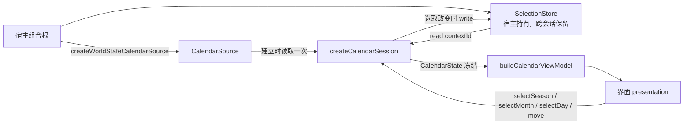

# 44 · 1999 日历应用操作流程（CAL-03）

对应 Issue [#15 CAL-03：建立日历应用操作流程](https://github.com/Dreamsunqing/1020-pbex-wfcd-zlk/issues/15)，依据 Issue [#11 1999 日历功能模组化与 CI 开发计划](https://github.com/Dreamsunqing/1020-pbex-wfcd-zlk/issues/11)，建立在 [41 · 架构决策与公开契约](41-1999日历架构决策与契约.md) 与 [42 · 领域规则](42-1999日历领域规则.md) 之上。

本章只描述 application 层：选季、选月、选日、键盘移动、选取恢复与视图模型。选取存储的具体实现（CAL-05）、DOM 界面与宿主接入属于其他 issue；现有世界状态页面仍使用原来的日历卡片，行为不变。

## 一、范围

| 文件 | 内容 |
|---|---|
| `src/features/calendar-1999/application/calendar-session.mjs` | `createCalendarSession`：读取来源、初始选取、恢复、季度／月份／日期选取、方向键与 Home／End |
| `src/features/calendar-1999/application/view-model.mjs` | `buildCalendarViewModel`：`CalendarState → CalendarViewModel` 的纯函数，42 格网格 |
| `src/features/calendar-1999/application/ports.mjs` | `CalendarOperations` 与 `BuildCalendarViewModel` 的说明补上本章的决定，契约字段不变（仍为 1.1.0） |
| `src/features/calendar-1999/index.mjs` | 公开 `createCalendarSession`；视图模型留在功能内部，由界面层导入 |
| `test/calendar/application.test.mjs` | 以假来源与假存储测试会话与视图模型，另有一项经 CAL-04 转接器的隔离测试 |

## 二、数据流



- 会话建立时调用 `source.read()` 一次，以 `validateCalendarDocument` 检查；不合法时抛 `TypeError`，`error.issues` 列出全部问题，宿主可据此保留旧会话或回退旧卡片。
- 合法文档会被深拷贝并冻结。来源之后再改动自己的对象，或界面试图改动返回的状态，都不会影响会话。
- 每个季度在建立时以 CAL-02 的 `buildSeasonMonths` 对齐一次，之后的操作只查表。
- 会话不读取时钟、DOM、`localStorage` 或 Electron；平台能力由宿主经端口注入。

## 三、操作接口

| 操作 | 行为 | 写入存储 | 无效输入 |
|---|---|---|---|
| `read()` | 返回冻结的 `CalendarState` | 从不 | — |
| `selectSeason(index)` | 切换季度，月份重置为第一个月，日期清空 | 选取改变时 | 不是 `0..季度数-1` 的整数：`RangeError` |
| `selectMonth(index)` | 切换当前季度的月份，日期清空 | 选取改变时 | 不是当前季度月份索引的整数（未映射季度没有月份）：`RangeError` |
| `selectDay(ordinal)` | 选择当前月内的日期 | 选取改变时 | 不是当前月的全年日序（含 `'96'`、`96.5`、`null`）：`RangeError` |
| `move(key)` | 见第五节，处理成功返回 `true` | 选取改变时 | 未知按键或目标不在本季：返回 `false`，不抛错 |

共同规则：

1. **先写存储，再改会话**。存储的 `write` 抛错时，错误原样抛出，当前会话状态保持原样。存储是否已改变取决于其实现；会话不提供存储回滚，也不能保证「先保存再抛错」的存储仍保持原样。CAL-05 已把原子写入定为 `SelectionStore` 契约，由存储实现保证，见 [45 · 第四节](45-1999日历选取存储转接器.md#四读写规则)；处理经过见第十一节第 2 项。
2. **重复选择当前项为空操作**：再次选择当前季度、月份或日期，不清空日期，也不写入存储。界面可以放心在点击当前标签时调用操作。
3. **失败不留痕迹**：抛 `RangeError` 或 `move` 返回 `false` 时，状态与存储都不变，不静默截断到最近的合法值。
4. 写入的值是副本，存储之后修改该对象不会影响会话。

## 四、初始选取与恢复

### 初始策略

没有可用的存储值时：

1. 第一个季度（索引 0）；
2. 该季度的第一个月；
3. 该月第一个有事件的日期；该月没有事件时不选日期（`ordinal: null`），不推定任何日期。

`selectSeason`、`selectMonth` 依 CAL-01 契约清空日期，不套用第 3 步；初始策略只用于打开日历与恢复回退。

### 恢复与逐级回退

存储值先经 `validateSelectionValue`，再检查它是否仍适合当前文档。从第一个不适合的部分开始，由初始策略重新决定：

| 存储值 | 结果 |
|---|---|
| 不是合法的 `SelectionValue`（`undefined`、字符串、`monthIndex: 3`、`ordinal: 366` 等） | 初始策略 |
| 季度索引超出文档的季度数 | 初始策略 |
| 季度存在，月份索引超出该季月份（例如未映射季度只能是月份 0） | 保留季度，月份与日期按初始策略 |
| 季度与月份存在，日期不在该月 | 保留季度与月份，日期为该月第一个有事件的日期或 `null` |
| 全部适合（含 `ordinal: null`） | 原样恢复 |

- 只复制 `seasonIndex`、`monthIndex`、`ordinal` 三个字段；存储中的额外字段（例如 `completed`）不会进入会话。选取只是日历上的日期，不代表个人完成进度。
- **建立会话从不写入存储**。存储只保存用户的操作结果；无效值留在存储中也无妨，每次建立都会重新检查。

## 五、键盘行为

`move(key)` 只接受 `ArrowLeft`、`ArrowRight`、`ArrowUp`、`ArrowDown`、`Home`、`End`，大小写必须一致；其他值（含 `'constructor'`、数字、`Symbol`）返回 `false`。

| 按键 | 行为 | 示例（1999 年春季） |
|---|---|---|
| `ArrowLeft`／`ArrowRight` | 前一天／后一天 | 4 月 30 日 → 5 月 1 日（切换到 5 月） |
| `ArrowUp`／`ArrowDown` | 前一周／后一周 | 5 月 3 日 → 4 月 26 日 |
| `Home` | 当前周（周日起）的第一天，限在当前月内 | 4 月 14 日（周三）→ 4 月 11 日；4 月 2 日 → 4 月 1 日 |
| `End` | 当前周的最后一天，限在当前月内 | 4 月 14 日 → 4 月 17 日；4 月 29 日 → 4 月 30 日 |

- **可跨月，不跨季**：方向键可在本季三个月之间移动，`monthIndex` 随之改变；目标落在本季之外（4 月 1 日向左、6 月 30 日向右、6 月 28 日向下）返回 `false`，选取不变。这解决了 [41 · 未决问题 2](41-1999日历架构决策与契约.md#七未决问题)。换季只能经 `selectSeason`；同一份文档中的多个季度共用该文档的 `contextId`，切季不会更换存储键，也不分别记忆每季的日期。
- **没有选中日期时**：`End` 选中本月最后一天，其他五个键选中本月第一天，让键盘焦点可以进入网格。
- **目标就是当前日期**（例如周六按 `End`）：返回 `true`，不写入存储。
- 没有月份的季度：任何按键都返回 `false`。

## 六、来源更新时的状态处理

依 [ADR-007](41-1999日历架构决策与契约.md#adr-007)，会话不提供刷新方法。新快照到达时，宿主以同一个 `SelectionStore` 建立新的来源与会话：

| 情况 | `contextId` | 结果 |
|---|---|---|
| 同一季度的新快照（`kind`、`stale`、`sourceTime` 改变） | 相同 | 恢复先前选取；状态如实反映新快照的新旧 |
| 同一季度，所选日期的事件被移除 | 相同 | 日期仍被恢复，`entries` 为空、`kind` 为 `null`，不补假事件 |
| 不同服务器、轮回或季度窗口 | 不同 | 初始策略；其他 `contextId` 的选取留在存储中，互不影响 |
| 宿主自定的 `contextId` 不变，但季度或月份已不同 | 相同 | 第四节的逐级回退 |
| 新快照无法通过校验 | — | 建立会话抛 `TypeError`，旧会话不受影响 |

隔离由 CAL-04 转接器的 `contextId` 规则保证（[43 · 第五节](43-1999日历世界状态转接器.md#五规则与边界)）；会话只按 `contextId` 读写，不自行比较服务器或季度。上述不同季度窗口的隔离指来源文档的季度组成改变时使用不同的键；同一份多季度文档内调用 `selectSeason` 仍共用一个键，只保存最后一次选取。两种情况的验收边界见第十一节第 1 项。

## 七、视图模型

`buildCalendarViewModel(state)` 只读传入的状态，不读会话、存储或时钟，不修改状态；相等的状态得到相等的模型。

| 字段 | 内容 |
|---|---|
| `seasonOptions` | 每个季度的 `label` 与 `yearIteration`，顺序即 `selectSeason` 的索引 |
| `activeSeasonIndex`／`activeSeason` | 当前季度索引；季度代码、名称、轮回与起止时间，没有季度时为 `null` |
| `monthTabs` | 每个显示月份的 `month`、`selected`、`eventDays`，顺序即 `selectMonth` 的索引 |
| `grid` | `{month, cells}`，`cells` 固定 42 格，从周日开始；1 日放在其 UTC 星期下，其余为 `null`。没有月份时 `grid` 为 `null` |
| `grid.cells[]` | `day`、`ordinal`、`date`、`weekday`、`listed`、`kind`、`selected`、`entryCount` |
| `selectedDay` | 选中日的 `ordinal`、`date`、`weekday`、`kind`、`listed` 与全部 `entries`；没有选中日时为 `null` |
| `unmapped` | 当前季度无法放到日期上的事件，按来源顺序 |
| `status` | `server`、`sourceKind`、`stale`、`sourceTime` |

- `entries` 与 `unmapped` 是会话中冻结的原对象，完整物品 ID、`libraryId` 与 `evidence` 原样到达界面。
- 1999 年 4 月 1 日为周四：前 4 格为空，接着 30 天，最后 8 格为空。5 月 1 日为周六，6 月 1 日为周二。
- 界面层由 `presentation/` 内部导入此函数，因此不经 `index.mjs` 公开；宿主只需要 `createCalendarSession`。

## 八、相对 MVP 原型的修正

| MVP 原型（`calendar-session.mjs`）的做法 | CAL-03 |
|---|---|
| `read()` 每次都写入选取存储 | `read()` 为纯函数；只有改变选取的操作写入（[ADR-005](41-1999日历架构决策与契约.md#adr-005)） |
| `read()` 会在月份内自动补选第一个有事件的日期 | 初始策略只在建立时使用；`selectMonth` 依契约清空日期 |
| 存储值以 `{...default, ...stored}` 合并，额外字段与错误类型都会进入状态 | 先经 `validateSelectionValue`，再检查是否适合文档，只取三个字段 |
| 失效值整组重置或在读取时被改写 | 逐级回退，保留仍有效的季度与月份 |
| 只检查 `seasons` 是数组与 `contextId` | 以 `validateCalendarDocument` 检查整份文档，失败时列出全部问题 |
| 直接使用来源返回的对象 | 深拷贝并冻结，来源与界面都无法改动会话 |
| 方向键不跨月 | 可在本季三个月之间移动，不跨季 |
| 界面自行组装 42 格与详情 | `buildCalendarViewModel` 产生模型，界面只绘制 |

## 九、验收对照（Issue #15）

| Issue 要求 | 测试（`test/calendar/application.test.mjs`） |
|---|---|
| 透过资料来源契约取得模型 | `a session reads its source once…`；`missing ports and invalid documents are rejected…` |
| 初始选取策略 | `a session reads its source once and opens on the first event day…` |
| 季度、月份与日期选取 | `season, month and day selection follow the contract…`；`choosing the active season, month or day again…` |
| 方向键及 Home／End | `arrow keys move by day and week across the months…`；`Home and End stay in the selected week row…`；`without a selected day the keys enter the month…` |
| 选取状态恢复 | `a stored selection is restored for its context…` |
| 验证无效操作参数；无效操作不破坏既有状态 | `invalid arguments throw RangeError…`；`a failing store write leaves the session unchanged` |
| 来源更新时的状态处理；失效选取安全回退 | `servers, seasons and loops keep isolated selections…`；`a stored selection is restored…`（逐级回退） |
| 选取符合服务器、季度及轮回隔离 | `servers, seasons and loops keep isolated selections…`（经 CAL-04 转接器，DE／WG、轮回 24／25、两个季度窗口；覆盖不同文档的 `contextId`，同一多季度文档内切回原季度的回归待补，见第十一节第 1 项） |
| 输出供画面使用的模型；画面不必重复实作选日规则 | `the view model lays a month on 42 slots…`；`the view model is pure…`。已验证应用层输出，尚未验证现有画面接入，见第十一节第 4 项 |
| 可以用假资料来源与假储存介面测试 | 除隔离测试外，全部使用 `fakeSource` 与 `fakeStore` |
| 不直接操作 DOM，不直接使用 localStorage 或 Electron | `the application layer touches no DOM, storage, Electron or clock…`（静态检查导入与全局名称；执行时把 `document`、`window`、`navigator`、`localStorage`、`sessionStorage`、`fetch` 与「现在」的时钟换成一读取就抛错的替身） |
| 来源与状态不被修改 | `the session copies and freezes its snapshot…`；其中事件对象冻结的断言可能误判通过，待修正后复核，见第十一节第 3 项 |

```sh
node --test test/calendar/application.test.mjs
npm test
```

## 十、已知限制与后续

1. **选取存储（CAL-05）**：本章测试使用假存储；内存实现 `createMemorySelectionStore` 及存储规则见 [45 · 选取存储转接器](45-1999日历选取存储转接器.md)，跨重启保存仍属后续 issue。依第三节第 1 条，`write` 抛错会让该次操作失败。
2. **界面与宿主接入**：`presentation/` 与宿主组合根尚未建立，`src/ui` 仍未调用会话；属于后续界面整合 issue。
3. **架构检查**：本章的测试只扫描 application 层；全功能的依赖检查器（`scripts/check-calendar-architecture.mjs`）属于后续 issue。
4. **初始季度**：核心不读时钟，因此初始季度固定为第一个季度，不依「今天」挑选。若需要按当前时间选季，应由宿主传入 `now` 并新增 ADR。
5. **CAL-04 待修正项**：[43 · 第九节](43-1999日历世界状态转接器.md#九审查待办与验收条件) 的事件映射与空季度问题修正后，会话不需改动；季度为空时会话已能给出空状态。
6. **分支基准**：2026-11-01，远端 `refactor/15-extract-calendar-application-flow` 由 `main` 的 `ae220f2` 建立，而 `main` 已 revert CAL-01（PR #22）与 CAL-02（PR #21）。本次改为从开发整合分支 `origin/refactor/11-calendar-1999-ui-mvp` 的 `8792900` 建立本地分支，包含 CAL-01、CAL-02 与 CAL-04（PR #25）。推送前需以本地分支取代远端分支；PR 以 `refactor/11-calendar-1999-ui-mvp` 为目标分支。

## 十一、审查待办与验收条件

2026-11-01 CAL-03 首次复核记录：当时应用层主要工作符合 Issue #15 的范围，日历测试 50／50 通过。随后 CAL-05 已补充端口说明与两项回归，勾选结果及范围说明以下文为准；最新 59 项日历测试与全项目验证见 [45 · 第十二节](45-1999日历选取存储转接器.md#十二本轮完成确认与下一-issue-移交)。测试通过不能代替边界确认，未勾选仍表示后续未完成，不代表本次新增逐季记忆需求。

### 1. 季度隔离的说明与回归范围（CAL-03／Issue #15）

事实与复现：同一份包含春季、夏季的文档只使用一个 `contextId`。春季选 4 月 14 日 → 切换夏季并选日 → 返回春季后，选取为 `{seasonIndex: 0, monthIndex: 0, ordinal: null}`，存储中仍只有一个键。此行为符合既有「切季重置月份、清空日期」契约；Issue #15 没有要求分别记忆每季上次选取，因此不直接判为功能错误。

- [x] 修正本章第五、六节的说明，区分「不同来源文档的上下文隔离」与「同一文档内的季度切换」。
- [x] 在 `test/calendar/application.test.mjs` 补充同一文档内 A 季选日 → B 季选日 → 返回 A 季的回归，验证日期清空、月份重置及共用存储键的实际约定；不得把现有跨文档隔离测试当作此场景的证明。CAL-05 补上 `all seasons of one document share its context key…`：春季选 4 月 14 日 → 夏季选 7 月 1 日 → 返回春季，选取为 `{0, 0, null}`，存储只有一个键，新会话恢复同一值。
- [x] 2026-11-01 本轮依既有契约确认范围：不同上下文不串用，同文档切季重置，不把逐季历史记忆当作 CAL-05 新增要求。开发者计划下一 issue 集中整理限制与后续工程，记录见 [45 · 第十一节第 1 项](45-1999日历选取存储转接器.md#1-季度隔离语义与历史选取限制)。若后续决定各季分别恢复日期，应先更新 ADR、来源识别、`SelectionStore` 与操作契约，再增加功能与测试。

2026-11-01 CAL-05 范围确认补充：上述回归验证现有切季重置契约，不代表逐季历史记忆已经实现。新快照只新增其他季度时也会改变 `contextId`，令原季度在新来源回退，旧选取仍保留在旧键下。这是当前来源识别与恢复策略的限制；前次直接把两者列为 #17 阻碍的解释已修正。开发者计划下一 issue 集中整理，后续是否增加逐季记忆、如何稳定季度识别及对应验收见 [45 · 第十一节第 1 项](45-1999日历选取存储转接器.md#1-季度隔离语义与历史选取限制)。

### 2. 写入失败时的保证范围（CAL-03／CAL-05）

相关位置：`application/calendar-session.mjs` 的文件头注释与 `commit()`、`application/ports.mjs` 的 `SelectionStore` 契约，以及测试 `a failing store write leaves the session unchanged`。

复现：注入一个 `write(key, value)` 先更新 Map、再抛错的假存储。初始选取 4 月 6 日，调用 `selectDay(104)` 后抛错；会话仍是 4 月 6 日，但存储已是 4 月 14 日，新会话也会恢复成 4 月 14 日。目前测试只覆盖「尚未写入就抛错」，不能证明存储也保持原样。

- [x] 修正本章第三节：仅保证写入抛错时当前会话不提交，不承诺会话能够回滚存储。
- [x] 同步修正 `calendar-session.mjs` 文件头中「a failing write leaves both as they were」的过度保证。CAL-05 改为：写入失败时会话不变；存储不变只因 `SelectionStore.write` 为原子写入，会话不会再次写入来回滚。
- [x] 明确 CAL-05 的失败契约：若要求存储也保持原样，必须由存储实现保证写入原子性；否则明确记录失败后存储状态可能已改变。不要通过会话再次写入旧值来假设回滚一定成功。CAL-05 选择前者：`ports.mjs` 规定 `write` 要么保存整个值，要么抛错并保持原值；内存实现先检查再保存，见 [45 · 第四节](45-1999日历选取存储转接器.md#四读写规则)。
- [x] 增加「先保存再抛错」的假存储测试，验证当前会话不变，并依选定契约验证存储与重新开会话的结果；保留原有「写入前抛错」测试。CAL-05 补上 `a store that saves and then throws breaks the atomic write contract…`：会话保持 4 月 6 日且只写入一次；违反契约的存储保留了 4 月 14 日，新会话因此恢复 4 月 14 日。

此问题是额外文档保证与端口契约的缺口，不等同于 Issue #15 已要求处理所有持久化失败。

### 3. 事件对象冻结测试可能误判通过（CAL-03）

相关测试：`test/calendar/application.test.mjs` 的 `the session copies and freezes its snapshot…`。测试先选择 5 月 10 日（130），再向右移动到没有事件的 5 月 11 日（131）；此时 `state.selected.entries[0]` 为 `undefined`。向其 `.title` 赋值本身就会抛 `TypeError`，即使事件对象没有冻结，也可能让断言通过。这是测试缺口，尚不能据此认定实际冻结实现有问题。

- [ ] 保留原有来源不变的验证，另取有事件的选中日作为冻结断言的对象。
- [ ] 修改属性前先断言事件存在，并检查 `Object.isFrozen(entry)`；再验证修改已有属性抛错且原值不变。视需要同时验证嵌套的奖励与证据对象。
- [ ] 运行 `node --test test/calendar/application.test.mjs` 与 `node --test test/calendar/*.test.mjs`，确认修正后的断言及其他恢复、键盘、隔离用例继续通过。

2026-11-01 CAL-05 复核补充：再次确认选中日为 131、`entries[0]` 为 `undefined`。Issue #15 已关闭，目前没有 open issue 承接；开发者计划下一 issue 集中整理，此测试修正可后续处理，应在新功能整合验收前补正。建议范围见 [45 · 第十一节第 4 项](45-1999日历选取存储转接器.md#4-后续-issue-规划建议尚未建立)，其中 CAL 编号尚未分配，不表示已建立追踪。

### 4. 应用层完成与画面接入分开跟进（Issue #11 后续整合）

现状：`createCalendarSession` 与 `buildCalendarViewModel` 已提供可复用操作和画面模型，但 `src/ui` 尚未调用它们。第九节的测试只证明应用层能力，不能证明现有 App 画面已经完成替换。此项与独立页面、完整架构检查及 CI 属于 Issue #11 后续工作，不作为本次 CAL-03 的新增工作范围。

- [ ] 在后续界面整合 issue 中记录并引用本节：接入 Session／ViewModel，避免画面保留另一套选日规则。
- [ ] 接入后验证切月、选日、键盘与焦点、新快照重建和恢复，并确认旧日历入口、奖励图片及资料库跳转继续可用。
- [ ] 按 Issue #11 补齐独立页面、实际选取存储、架构依赖检查、CI、浏览器与 Electron 整合验证；未完成前不宣称总计划全部通过。

CAL-04 已知的事件映射、日期判断重复与无事件季度资料遗失，继续以 [43 · 第九节](43-1999日历世界状态转接器.md#九审查待办与验收条件) 为跟进依据；本章不将这些待办标成已修复。分支基准与 PR 目标的限制见第十节第 6 项，发布前应按实际远端状态重新确认。

### 5. 完整测试与检查的环境问题（项目验证）

2026-11-01 审查时，`npm test` 为 287 项：280 通过、7 失败；日历 50 项全部通过。`npm run check` 的 232 个文件语法检查通过，但生成登记表比对失败。失败项涉及的文件不属于本次 CAL-03 改动；不能将此记录解读为全项目检查已通过。

| 数量 | 失败位置与原因 | 跟进与验收 |
|---|---|---|
| 4 | `documents.test.mjs`、`gallery.test.mjs`、`library.test.mjs`、`local-images.test.mjs`：创建符号链接时报 `EPERM`；沙箱外定点重跑后仍失败 | 确认 Windows 建立符号链接所需权限或开发者模式，并重跑相关用例；如需平台条件处理，应明确报告未验证范围，不能静默当作通过 |
| 1 | `gallery.test.mjs`：用 `/src\/ui\/assets\/text-icons/` 比对 Windows 反斜线路径 | 改为跨平台路径比较，并验证 Windows 与使用正斜线的平台 |
| 2 | `inline-tokens.test.mjs` 与 `merge-rule-help.test.mjs`：生成内容比对受 CRLF／LF 影响 | 相关文件与 HEAD 在忽略换行差异后相同；合并说明的生成区在统一换行后也一致。确认换行策略并修正比对或检出设置，再跑测试及 `npm run check` |

- [ ] 跟进上述 7 项环境／跨平台问题；保留实际失败原因，不将它们归为日历应用层回归。
- [ ] 修正后重新记录 `npm test` 与 `npm run check` 的结果；本节历史记录不替代最新运行结果。

2026-11-01 CAL-05 复核补充：全量测试为 296 项：289 通过，失败仍是这 7 项。目前没有 open issue 承接，建议的承接 issue（CAL-11）见 [45 · 第十一节第 4 项](45-1999日历选取存储转接器.md#4-后续-issue-规划建议尚未建立)。
