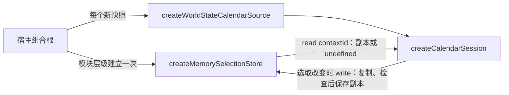

# 45 · 1999 日历选取存储转接器（CAL-05）

对应 Issue [#17 CAL-05：建立选取状态存储转接器](https://github.com/Dreamsunqing/1020-pbex-wfcd-zlk/issues/17)，依据 Issue [#11 1999 日历功能模组化与 CI 开发计划](https://github.com/Dreamsunqing/1020-pbex-wfcd-zlk/issues/11)，建立在 [41 · 架构决策与公开契约](41-1999日历架构决策与契约.md) 与 [44 · 应用操作流程](44-1999日历应用操作流程.md) 之上。

本章只描述 `SelectionStore` 端口的规则与内存实现。跨 App 重启保存、界面与宿主接入属于其他 issue；现有世界状态页面仍使用原来的日历卡片，行为不变。

2026-11-01 本轮交付范围确认：开发者决定在下一个 issue 统一整理相关问题。本次 CAL-05 按既有端口与会话契约验收：不同 `contextId` 的值独立，服务器、季度窗口及轮回变化时不套用不相符的选取；同一文档内切季仍重置月份与日期，不新增逐季历史记忆。按此范围，Issue #17 的六项工作与五项验收已有实现和测试支持。第十一节保留限制、既有缺陷及后续验收，未勾选的是待移交工作，不代表本次必须全部实现。此结论不表示 Issue #11 总计划完成，也不表示 GitHub 的 checkbox 已更新。

## 一、范围

| 文件 | 内容 |
|---|---|
| `src/features/calendar-1999/adapters/memory-selection-store.mjs` | `createMemorySelectionStore`：内存版 `SelectionStore` |
| `src/features/calendar-1999/application/ports.mjs` | `SelectionStore` 的说明补上本章的决定：存储内容、隔离键、复制、读取不抛错、原子写入、不自行失效。契约字段不变（仍为 1.1.0） |
| `src/features/calendar-1999/application/calendar-session.mjs` | 只修正文件头注释：写入失败时会话不变；存储不变由原子写入契约保证 |
| `src/features/calendar-1999/index.mjs` | 公开 `createMemorySelectionStore` |
| `test/calendar/selection-store.test.mjs` | 存储本身、经会话与 CAL-04 转接器的隔离、替换存储实现、依赖方向 |
| `test/calendar/application.test.mjs` | 补两项回归：先保存再抛错的存储；同一文档内切季共用键（[44 · 第十一节](44-1999日历应用操作流程.md#十一审查待办与验收条件) 第 1、2 项） |
| `test/calendar/contracts.test.mjs` | 公开入口新增 `createMemorySelectionStore` |

## 二、数据流与宿主用法



```js
import { createCalendarSession, createMemorySelectionStore, createWorldStateCalendarSource } from '../features/calendar-1999/index.mjs';

// 存储放在模块层级，所有会话共用；每个新快照只建立新的来源与会话。
const calendarSelections = createMemorySelectionStore();
const openCalendar = view => createCalendarSession({ source: createWorldStateCalendarSource(view), selectionStore: calendarSelections });
```

- 存储必须比会话活得久。每次重绘都新建存储，选取就无法跨快照延续。
- 国际服与国服可以共用一个存储，因为 `contextId` 已包含服务器；各建一个结果相同。
- 工厂不接受外部 `Map`。宿主若持有存储内部的对象，就能绕过检查直接改动已存的值。

## 三、存储内容与隔离键

| 项目 | 规则 |
|---|---|
| 键 | 文档的 `contextId`，非空字符串，与 `validateCalendarDocument` 的 `contextId` 规则相同。存储不修剪、不解析、不比较文档 |
| 值 | `SelectionValue` 的三个字段：`seasonIndex`、`monthIndex`、`ordinal`。其他字段（例如 `completed`）丢弃；选取只是日历上的日期，不代表个人进度 |
| 粒度 | 一个 `contextId` 一个值。同一文档内的多个季度共用一个键，只保存最后一次选取，不逐季记忆 |
| 隔离来源 | 只来自 `contextId`。CAL-04 转接器在服务器、季节代码、轮回或开始时间任一不同时给出不同的 `contextId`；`kind`、`stale`、`sourceTime` 不影响（[ADR-005](41-1999日历架构决策与契约.md#adr-005)、[43 · 第五节](43-1999日历世界状态转接器.md#五规则与边界)） |

| 情况 | 键 | 结果 |
|---|---|---|
| 国际服与国服 | 不同 | 各自保存，互不影响 |
| 轮回 24 与 25 | 不同 | 各自保存 |
| 不同季度窗口（不同来源文档） | 不同 | 各自保存 |
| 同一季度的新快照，季度组成不变 | 相同 | 恢复先前选取 |
| 同一文档内调用 `selectSeason` | 相同 | 按既有会话契约重置月份、清空日期；回到原季度时不恢复历史选取。不同季度的日期不会直接沿用，逐季记忆属于后续范围，见第十一节第 1 项 |
| 新快照只新增、移除或重排其他季度，原季度不变 | 不同 | `contextId` 包含全部季度，新来源回到初始策略；旧值仍在旧键下，并未删除。保留未变动季度的历史选取属于后续来源识别与恢复策略改进，见第十一节第 1 项 |

## 四、读写规则

1. **`read(contextId)`**：有值时返回新的副本；没有值时返回 `undefined`。不抛错，传入从未能写入的键（`null`、数字、对象、`Symbol`）也只返回 `undefined`。
2. **`write(contextId, value)`**：检查键，再把三个字段复制成副本（每个字段只读一次），检查副本，通过后保存的就是这个副本。键不是非空字符串，或副本不通过 `validateSelectionValue` 时抛 `TypeError`（值的问题列在 `error.issues`），存储保持原样。先复制再检查，getter 或 Proxy 就无法让检查看到一个值、存储留下另一个值。
3. **复制**：写入后修改原对象、修改读取结果，都不影响存储；每次读取都是不同的对象。冻结的值（例如会话的 `selection`）也可以写入，读回的是可以修改的新对象。
4. **存储对象冻结**：宿主无法替换 `read` 或 `write`。

### 原子写入

[44 · 第十一节第 2 项](44-1999日历应用操作流程.md#2-写入失败时的保证范围cal-03cal-05) 要求 CAL-05 明确失败契约。本章的决定：

- **契约**：`write` 要么保存整个值，要么抛错并保持原值。这是所有 `SelectionStore` 实现的责任，已写入 `ports.mjs`。内存实现先复制并检查、最后才一次 `Map.set`，自然满足。
- **会话**：先写存储再提交。`write` 抛错时会话不变，也不会再写一次旧值去「回滚」，因为回滚写入同样可能失败。
- **不符合契约的存储**（先保存再抛错）：会话仍不变，但存储已经改变，下一次建立会话会恢复该值。测试 `a store that saves and then throws breaks the atomic write contract…` 记录此边界：存储的一致性只能由存储实现保证。

## 五、不存在与损坏状态

| 情况 | 存储 | 会话 |
|---|---|---|
| 键没有值 | `read` 返回 `undefined` | 初始策略 |
| 写入损坏值（字符串、数组、`seasonIndex: '0'`、缺少 `ordinal`、`monthIndex: 3`、`ordinal: 366`、`96.5` 等） | 拒绝写入，保持原值 | 不会发生：会话只写合法值 |
| 其他实现读回损坏数据（例如持久化文本无法解析，或解析结果不是 `SelectionValue`） | 应返回 `undefined` 或读到的原值，不抛错 | `validateSelectionValue` 不通过，使用初始策略 |
| 值合法，但不适合新文档 | 原样保留 | 逐级回退（[44 · 第四节](44-1999日历应用操作流程.md#四初始选取与恢复)） |

内存实现的 `Map` 只保存通过检查的副本，因此本身不会出现损坏值。损坏只可能来自日后的持久化实现；即使如此，会话的校验与回退仍然有效，测试以一个保存 JSON 文本的替代存储验证这一点。

## 六、来源改变时的失效策略

- **存储不主动失效**：不按时间淘汰，不在读取时改写，也不比较文档。
- **由会话在恢复时判断**：是否适合新文档由会话决定（44 · 第四节）。不适合的值留在存储中，直到用户再次选择时被覆盖；建立会话从不写入存储。
- **`contextId` 改变**（新季度、新轮回、换服）：新键没有值，使用初始策略；旧键保留，切回原服务器或旧季度的快照仍可恢复。
- **容量**：每个 `contextId` 只保存三个数字。季度每周轮换，一次运行累积的键很少，本阶段不设上限。日后的持久化实现若长期保存，再决定保留规则，例如移除已结束季度的键。

## 七、保存期限：本阶段不含跨重启保存

- 内存实现只在宿主持有该实例期间有效，也就是渲染进程的生命周期；App 重启后选取回到初始策略。
- 存储模块不使用 `localStorage`、文件、Electron 或时钟；测试以静态检查确认。
- 跨重启保存应另开 issue：新增一个实现同一端口的适配器，遵守第四、五节（读取不抛错、损坏视为没有值、原子写入），不与个人游戏进度（完成记录、领取状态）共用数据，也不需要修改 domain 或 application。

## 八、相对 MVP 原型的修正

| MVP 原型（`memory-selection-store.mjs`）的做法 | CAL-05 |
|---|---|
| 工厂接受外部 `Map`，宿主可直接改动其中的值 | 不接受外部 `Map`，内部 `Map` 私有 |
| 以 `{...value}` 复制全部字段，`completed` 等也会保存 | 只保存三个字段 |
| 写入不检查，损坏值或空键会进入存储 | 先检查键与值，拒绝时存储不变 |
| 返回可修改的存储对象 | 存储对象冻结 |
| 写入失败的结果未定义 | 原子写入写进端口契约 |

## 九、验收对照（Issue #17）

| Issue 要求 | 证明（未注明者为 `test/calendar/selection-store.test.mjs`） |
|---|---|
| 实现内存版本的 SelectionStore | `createMemorySelectionStore`；`a new store is empty…` |
| 定义存储内容及隔离键 | **通过**。第三节与 `ports.mjs`；`a new store is empty…` 验证只留三个字段、键不解析。一个文档上下文一笔选取；同文档切季与历史记忆的范围见本章开头及第十一节第 1 项 |
| 保护读写对象，避免共享可变引用 | `written objects and read results are copies…`；`behind a session the store holds only what the user chose…`；`invalid keys and damaged values…`（getter 每个字段只读一次） |
| 处理不存在及损坏状态 | 第五节；`invalid keys and damaged values are refused…`；`replacing the store implementation…`（损坏文本回退） |
| 定义来源改变时的失效策略 | **通过**。第六节；`behind a session…` 验证不适合的值逐级回退且保留到下一次选择。上下文改变后改读新键；其他季度组成变化也换键的限制已明列，不承诺逐季历史恢复 |
| 说明本阶段是否包含跨重启保存 | 第七节：不包含 |
| 国际服／国服互不影响 | `one store keeps servers, loops and season windows apart…` |
| 不同轮回及季度互不影响 | **按本轮确认范围通过**。同上测试验证轮回 24／25、不同季度时间窗各自保存；同文档切季按会话契约清空，避免沿用其他季度日期。`application.test.mjs` 的 `all seasons of one document share its context key…` 验证此行为，不代表已经具备逐季记忆 |
| 调用端修改读取结果，不会意外改变已存状态 | `written objects and read results are copies…`；`behind a session…` |
| 损坏状态可以回退 | `invalid keys and damaged values…`；`replacing the store implementation…`；`behind a session…` |
| 更换存储实现时，不需要修改日期规则 | `replacing the store implementation changes no calendar rule…`（内存实现与 JSON 文本实现得到相同状态）；`the store depends only on the application contract…`（domain、application 不导入任何 adapter） |

```sh
node --test test/calendar/selection-store.test.mjs
node --test test/calendar/*.test.mjs
npm test
```

## 十、已知限制与后续

1. **宿主尚未接入**：`src/ui` 仍未建立会话与存储；接入时按第二节，把存储放在模块层级。属于后续界面整合 issue。
2. **跨重启保存**：另开 issue，见第七节。
3. **多季度历史选取的限制**：同文档切季重置、季度组成改变后旧键的选取不被新来源恢复；本次遵循既有契约，逐季记忆与稳定季度识别交给下一 issue 评估，复现及后续验收见第十一节第 1 项。
4. **架构检查**：本章的测试只检查存储模块与 domain／application 的导入；全功能的依赖检查器（`scripts/check-calendar-architecture.mjs`）属于后续 issue。测试放在 `test/calendar/selection-store.test.mjs`，而不是 Issue #11 目录规划中的 `adapters.test.mjs`；`npm test` 以 `test/calendar/*.test.mjs` 收集，日后的 CI 也应使用同一通配，而不是逐一列出文件。
5. **完整测试**：2026-11-01，`npm test` 为 296 项：289 通过、7 失败；日历 59 项全部通过。7 项失败与 [44 · 第十一节第 5 项](44-1999日历应用操作流程.md#5-完整测试与检查的环境问题项目验证) 相同（符号链接 `EPERM` 4 项、Windows 路径比对 1 项、CRLF／LF 生成比对 2 项），不属于本次改动。`npm run check` 的 234 个文件语法检查通过，生成登记表比对仍失败，原因相同。
6. **分支基准**：`refactor/17-extract-calendar-selection-store` 由开发整合分支 `origin/refactor/11-calendar-1999-ui-mvp` 的 `bec4c0d` 建立，包含 CAL-01、CAL-02、CAL-04（PR #25）与 CAL-03（PR #26）。PR 以 `refactor/11-calendar-1999-ui-mvp` 为目标分支。

## 十一、审查待办与验收条件

2026-11-01 复核与交接记录。本轮重新区分当前储存职责、已接受的行为范围、既有缺陷与后续工程。较早审查把「每季都恢复上次日期」直接解释为季度隔离的必要条件，判断过于严格；Issue 没有明订逐季历史记忆，开发者已决定下一 issue 统一整理相关问题。本节以本章开头的范围确认取代较早「必须在 #17 改为分季储存」的判断。未勾选表示后续尚未完成，不应据此宣称 Issue #11 已完成。

### 1. 季度隔离语义与历史选取限制

对应要求：Issue #11「状态语义：不同季度及轮回的状态隔离」，Issue #17 验收「不同轮回及季度互不影响」，以及工作项目「定义存储内容及隔离键」「定义来源改变时的失效策略」。本次以不同上下文不串用、来源改变后安全恢复或回退验收；同文档切季重置已有契约与回归测试，逐季历史记忆不列入本次新增要求。

复现（使用真实的内存存储与会话）：

| 情况 | 操作 | 结果 |
|---|---|---|
| 同一文档内切季 | 春季选 104（4 月 14 日）→ 夏季选 182（7 月 1 日）→ 返回春季 | `ordinal: null`；再回夏季也是 `null` |
| 新快照只新增其他季度 | 经 CAL-04 转接器，DE 冬季选 19；新快照只新增一个春季，冬季本身不变 | `contextId` 改变，重新打开冬季回到 3；19 仍保存在旧键下 |

原因：

- 一份文档只存一笔 `SelectionValue`，而 `contextId` 包含全部季度清单。
- `seasonIndex` 是位置索引。季度重排时，经转接器会换键并回退；自定来源若在季度身份变化后仍复用同一 `contextId`，可能恢复到错误季度，因此宿主必须遵守上下文身份规则。
- 既有 `selectSeason` 契约规定切季重置月份、清空日期。若后续需要恢复各季历史选取，应同时调整会话与来源契约，不能只修改 Map 的存储方式。

影响：实际数据中，`src/core/live-state/view.mjs` 只把当前生效的季度放进 `calendarSeasons`，DE 与 WG 样本都只有一季；多季度来源会观察到上述重置与回退。`application.test.mjs` 的 `all seasons of one document share its context key…` 与 [44 · 第十一节第 1 项](44-1999日历应用操作流程.md#1-季度隔离的说明与回归范围cal-03issue-15) 验证目前已接受的切季行为，不能当作逐季历史记忆已经实现的证明。

相关位置：`application/ports.mjs`（`SelectionValue`、`SelectionStore`、`CalendarOperations.selectSeason`）、`application/calendar-session.mjs`（`restore`、`selectSeason`、`commit`）、`adapters/world-state-source.mjs`（`contextId`）、`adapters/memory-selection-store.mjs`、[ADR-005](41-1999日历架构决策与契约.md#adr-005)。

本轮已完成：

- [x] 在本章及端口说明写清一个上下文一笔选取、切季重置、季度组成改变后回退；依既有契约验收 #17。
- [x] 保留双服、不同轮回、不同季度窗口互不覆写的测试，以及同文档切季行为的回归。

下一 issue 需整理的决定与验收：

- [ ] 将本轮范围及已接受的限制回写 GitHub #17，并在 #11 连结下一 issue；此处记录不等于远端已经更新。
- [ ] 决定是否新增逐季历史记忆及未变动季度的稳定恢复。这是后续功能／契约改进，不预设必须实施。
- [ ] 若要新增：以服务器、季节代码、轮回与开始时间提供稳定的季度识别，定义最后启用季度及写入失败时的保证；不能未经验证就假设多笔写入原子。
- [ ] 若要新增：同步调整 ADR-005、来源键、`selectSeason` 与端口版本策略；验证 A 季选日 → B 季选日 → 返回 A、B 的各自恢复，以及其他季度新增、移除、重排时不连带丢失选取。
- [ ] 若要新增：继续验证换服、换轮回、新季度开始时间的隔离，并保留替换储存实现不改日期规则的测试。

### 2. 端口契约版本与一致性测试

- 本次在 `ports.mjs` 写清 `SelectionStore` 的行为要求（只存三个字段、读取不抛错、原子写入、不自行失效），结构版本仍为 1.1.0。当前仅交付内存实现，既有校验器与公开入口测试仍按此版本运行；没有因此发现本次实现不符合端口的结果。
- 内存实现已有专用测试，JSON 文本替代存储验证了会话可替换性；但尚未抽出所有实现都可套用的 `SelectionStore` 一致性测试。此项属于后续扩充储存实现时的维护工作。

- [ ] 在下一 issue 整理版本策略；若后续修改键、值或恢复语义，再依实际相容性决定版本，不预先指定 2.0.0。
- [ ] 将第四、五节的规则抽成可重用的一致性测试，内存实现与日后实现共用。

### 3. GitHub 追踪尚未更新

- Issue #17 的工作项目与验收 checkbox 未更新，也没有留言记录本轮范围与第 1 项的限制。
- Issue #15、#16 已关闭，其遗留只记在 [43 · 第九节](43-1999日历世界状态转接器.md#九审查待办与验收条件)、[44 · 第十一节](44-1999日历应用操作流程.md#十一审查待办与验收条件) 与 PR #25、#26 描述，没有 open issue 承接。
- Issue #11 后三段工程表（画面与整合、架构与品质防线、CI 与交接）仍为 `?`。

- [ ] 在下一 issue 建立时，回写 Issue #17 的完成范围、限制与验证结果；checkbox 依本章第九节的实际结果更新，不把后续逐季记忆或 #11 总计划误标为已实现。
- [ ] 为 #15、#16 的遗留建立承接 issue，或重新开启原 issue。
- [ ] 按第 4 项规划建立 issue，将编号、依赖与状态填回 Issue #11 工程表。

### 4. 后续 issue 规划（建议，尚未建立）

本次复核同时重现的非 #17 范围问题：

| 编号 | 复现 | 归属与现有记录 |
|---|---|---|
| R3 | 投影事件为 `CET_CHALLENGE`、`cardState.id` 人工设为 `reward` 时，转接器输出 `reward` | #16 遗留，[43 · 第九节第 1 项](43-1999日历世界状态转接器.md#1-cal-04-明确持有事件映射规则) |
| R4 | DE、WG 有效季度但所有日期 `events` 为空，经 `buildWorldView()` → 转接器都输出 0 个季度 | #16 遗留，43 · 第九节第 3 项 |
| R5 | 冻结测试最后选中 131（无事件），`entries[0]` 为 `undefined`，赋值抛错不能证明事件已冻结 | #15 遗留，[44 · 第十一节第 3 项](44-1999日历应用操作流程.md#3-事件对象冻结测试可能误判通过cal-03) |
| — | 转接器自订 `isAnnualDay`，未共用 domain；未造成日期错误 | #16 遗留，43 · 第九节第 2 项 |
| — | Windows 全量测试 7 项失败与 `npm run check` 生成登记表比对 | 环境问题，44 · 第十一节第 5 项 |

开发者计划先由下一个 issue 集中整理本节。下表为之后可拆分或合并的建议，`CAL-06` 至 `CAL-13` 都不是已建立或已保留的编号，不要求本次一次建立八个 issue。实际编号、拆分方式与依赖在下一 issue 整理时确定，再填回 #11 工程表。

| 建议 issue | #11 段落 | 主要范围 | 依赖 |
|---|---|---|---|
| CAL-06 修正世界状态转接器遗留问题 | 建立独立功能核心 | 由 `reference.events` 的 `CET_*` 映射再经 `classifyDay()` 汇总；定义 `events` 缺失或异常的处理；保留整季无事件的季度窗口与 `listedDays`；共用 domain `isAnnualDay`；以原始小型资料经 `buildWorldView()` 验证 DE／WG | #16；若后续新增稳定季度键，应与来源识别及恢复契约改进协调，完成于新 UI 整合验收前 |
| CAL-07 修正应用层冻结测试缺口 | 建立独立功能核心 | 改用有事件的选中日，先断言事件存在，再检查 `Object.isFrozen` 与嵌套 `rewards`、`evidence`；移除 `deepFreeze` 时测试应失败 | #15 |
| CAL-08 日历画面层与宿主整合 | 建立可替换的画面与整合 | `presentation/` 实现 mount／update／destroy；键盘、焦点与无障碍；选取存储放在宿主模块层级共用；新快照重建会话；注入 `CalendarCapabilities`；显示快照新旧；`libraryId` 为 `null` 的奖励图片策略；统一文案语言与「煞调变」名称；旧入口相容 | #15、#16、#17 |
| CAL-09 独立执行页面与浏览器、Electron 整合测试 | 建立可替换的画面与整合 | 小型固定资料的独立页面；浏览器测试选月、选日、键盘、焦点、图片缺失、跳转不可用；Electron 从世界状态页进入、返回、新快照重建 | CAL-08 |
| CAL-10 架构依赖检查器 | 建立架构与品质防线 | `scripts/check-calendar-architecture.mjs` 与 `architecture.test.mjs`：层级方向、只经 `index.mjs` 跨功能导入、禁止循环依赖与平台全局；以违规样本证明会拦截 | #12 |
| CAL-11 Windows 跨平台测试与检查 | 建立架构与品质防线 | 符号链接 `EPERM`、路径比对、CRLF／LF 生成比对；`npm test` 与 `npm run check` 在 Windows 与 Linux 通过，或明确列出跳过原因 | 无 |
| CAL-12 日历 GitHub Actions CI | CI 与交接 | `.github/workflows/calendar.yml`；以 `test/calendar/*.test.mjs` 通配收集；Windows 与 Linux 矩阵；执行架构检查与浏览器测试；失败时 PR 被拦截 | CAL-09、CAL-10、CAL-11 |
| CAL-13 交接与维护文件 | CI 与交接 | `1999日历架构与维护.md` 整合文件 41–45；测试报告、失败排查、已知限制、旧入口相容与移除说明；填回 #11 工程表 | 以上全部 |

暂不建立：跨 App 重启保存。Issue #17 备注已允许另开，不属于 #17 缺失；决定要做时再建立实现 issue（见第七节）。

- [ ] 在下一 issue 引用本节，确定要建立、合并及排序的工作，再记录实际编号；#15／#16 修正可后续完成，不要求并入 #17 分支。
- [ ] 建立后，在 43 · 第九节、44 · 第十一节与本节注明承接的 issue 编号。

## 十二、本轮完成确认与下一 issue 移交

本节按开发者「下一 issue 统一整理相关问题」的分工，确认当前实现与后续事项。CAL-05 的储存职责、内容与键、读写副本、缺值／损坏回退、来源失效策略及保存期限已完成；五项验收按第九节所述的当前上下文隔离契约验证。没有发现需要为了交付本次内存转接器而新增逐季记忆、平台储存或画面整合的依据。**此结论限定于 #17 本轮范围，不能用于关闭 #11 总计划。**

本轮实际重跑结果（2026-11-01）：

| 验证 | 结果与限制 |
|---|---|
| `node --test --test-reporter=tap test/calendar/*.test.mjs` | 59 项通过，0 项失败。包含 getter 每字段只读一次、无共享引用、非法写入不覆盖、双服／轮回／季度窗口隔离、损坏回退及替换实现 |
| `npm test` | 共 296 项，289 通过、7 失败。失败为符号链接 `EPERM` 四项、Windows 路径比对一项、生成内容 CRLF／LF 比对两项；失败相关实现与测试文件未在本次修改范围内，细节见 44 · 第十一节第 5 项 |
| `npm run check` | 234 个源码／脚本／测试文件语法检查通过；生成的文本图标登记表比对仍失败，不得记为整项通过 |
| `git diff --check` | 本轮修改无空白格式错误 |

下一 issue 可直接采用的移交清单：

| 待整理事项 | 当前状态 | 后续完成条件与时点 |
|---|---|---|
| 季度历史选取与稳定来源识别 | 当前行为与重现见第十一节第 1 项；本次不新增逐季记忆 | 先决定是否需要此体验；若需要，再同步修改来源、会话与端口，并补跨季恢复及季度清单变化回归 |
| #16 事件映射、整季无事件资料保留、共用日期判断 | 仍未修复；重现与详细验收见 43 · 第九节 | 建立承接追踪，在新 UI 整合验收前修正；不能因 #16 已关闭而视为消失 |
| #15 事件冻结断言 | 仍可能因操作 undefined 假通过；见 44 · 第十一节第 3 项 | 改用实际存在的事件，检查冻结与修改失败；整合验收前补正 |
| 端口版本与可重用一致性测试 | 当前结构版本 1.1.0，内存实现已有专用测试 | 整理后续版本策略；新增持久化实现或修改端口前提供共用规则验证 |
| 旧入口相容、图片与导航、宿主注入、独立页面、架构检查、CI 与整合验证 | 尚未完成；见第十一节第 4 项 | 依 #11 后续阶段实施；#11 结案前应有实际结果，而非只有规划 |
| Windows 与生成内容检查 | 仍有上述七项失败与 check 比对失败 | 跨平台 CI／交付验收前处理，并重新记录通过、失败或明确未验证的范围 |
| GitHub 留案及交接 | 下一 issue 尚未建立；#17 checkbox、#11 后续工程表未更新 | 下一 issue 建立时引用本章第九、十一、十二节，并连回 #11／#15／#16／#17，填入实际编号与依赖 |

跨 App 重启保存仍按 #17 备注另行决定，不作为本次缺失。交付提交必须同时包含新转接器、测试与本章，不能只提交已经追踪的文件而漏掉新增文件。本验收记录对应提交前的工作树；提交、推送及 GitHub Issue 的建立、更新或关闭另行执行。
