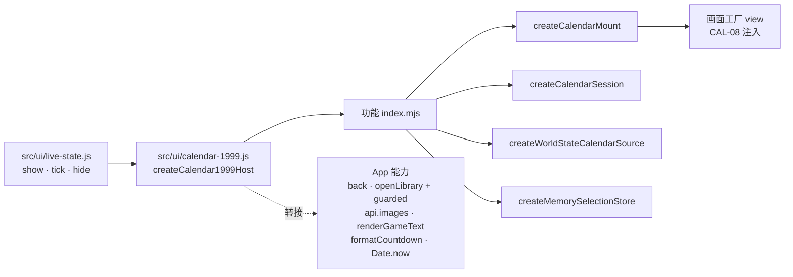

# 47 · 1999 日历 App 能力转接与组装入口（CAL-07）

对应 Issue [#30 CAL-07：建立 App 能力转接与组装入口](https://github.com/Dreamsunqing/1020-pbex-wfcd-zlk/issues/30)，依据 [#11](https://github.com/Dreamsunqing/1020-pbex-wfcd-zlk/issues/11) 的分层与 [41 · 架构决策与契约](41-1999日历架构决策与契约.md) 的外部能力及生命周期契约，并承接 [46 · HANDOFF-02](46-1999日历核心阶段完成度查核.md#四需求决定与已接受限制)。

目标：把日历与既有 App 的连接集中在少数入口。本章只做组装入口、能力转接与生命周期；画面重整属 CAL-08（#31），独立执行页面属 CAL-09（#32），完整架构检查器与 CI 属后续阶段。

## 一、范围

- 分支 `refactor/30-app-adapters-and-composition-root`，基于 `9588e05`（PR #29 合并后）。
- 本次新增与修改：

| 文件 | 层 | 内容 |
|---|---|---|
| `src/features/calendar-1999/application/calendar-mount.mjs` | application | 新增 `createCalendarMount`：单一挂载位置、能力租约、卸载后丢弃晚到结果 |
| `src/features/calendar-1999/application/contract-validation.mjs` | application | 新增 `validateCalendarCapabilities` |
| `src/features/calendar-1999/application/ports.mjs` | application | `CalendarCapabilities` 新增 `now`；补充失败、卸载后与挂载规则；新增 `CalendarMount` 契约 |
| `src/features/calendar-1999/index.mjs` | 公开入口 | 导出 `createCalendarMount`、`validateCalendarCapabilities` |
| `src/ui/calendar-1999.js` | 宿主组装入口 | 新增 `createCalendar1999Host`：注入来源、选取存储、物品导航、图片、游戏文字、关闭与倒数 |
| `src/ui/live-state.js` | 宿主 | 只在少数调用点接入组装入口；时间徽章改用共用的 `formatCountdown` |
| `src/core/live-state/presentation.mjs` | 宿主 | 新增纯函数 `formatCountdown(start, end, now)`，由原 `countdown` 抽出，行为不变 |
| `test/calendar/composition.test.mjs` | 测试 | 22 项：mount、能力守护、组装入口与边界检查 |
| `test/calendar/contracts.test.mjs` | 测试 | 公开入口清单加入两个新导出 |

## 二、组装关系

- `src/ui/calendar-1999.js` 是 App 唯一导入日历功能的模块，而且只经 `index.mjs`。
- 功能内部不出现 `window`、`workbench`、`ipcRenderer`、`electron`，也不导入功能目录以外的任何模块。
- 组装入口不读取 `window.workbench`，由 `live-state.js` 把已有的 `api`、`openLibrary`、`guarded`、`back` 交给它。

## 三、外部能力转接

| 能力 | App 实现 | 失败处理 | 卸载后 |
|---|---|---|---|
| `close()` | `live-state.js` 的 `back()`，回到世界状态 | 抛错由能力副本吸收并回报 | 不调用 `back()` |
| `openItem(ref)` | `libraryId` 为非空字符串且有 `openLibrary` 时，以 `guarded(() => openLibrary(libraryId, libraryVersion))` 打开资料库，返回 `true`；否则返回 `false` | 资料版本变化等异步失败由 `guarded` 通知用户，不回传日历；只有 `true` 算接受 | 返回 `false`，不调用 |
| `loadArt(ref)` | 以旧卡片同样的图片请求调用 `api.images`：按 `libraryId` 在宿主投影中找到该奖励的 `imageId`、`imageName`、`blueprint`、`resultId`、`resultImageName`、`icon`、`abilityIcon`；找不到时只送 `{id: libraryId}`。单图取 `dataUrl`，组合图取 `item` 层，否则取最上层 | 无 `libraryId`、无图片服务、无图、请求失败都为 `missing`；失败请求下次重试，「没有图」的答案在本次挂载内保留。CAL-10 起先查奖励图片映射（按完整 ID，`libraryId` 可为 `null`），映射无效或图档无法读取才走本栏流程，见 [50 · 第三节](50-1999日历奖励图片映射.md#三查图顺序宿主) | 未完成的请求永不 settle |
| `renderText(target, text, mode)` | `renderGameText`，未知标记保留原文 | 渲染器抛错时以纯文字写入原文并回报 | 不调用 |
| `formatDeadline(startsAt, endsAt, now)` | `formatCountdown`，与世界状态时间徽章共用；`ended` 为文字是否为「已结束」 | 无效时间为 `{text:'', ended:false}` | 仍可用（纯函数） |
| `now()` | `Date.now`（可注入） | 失败时为 `NaN` | 仍可用 |

「失败处理」「卸载后」两栏由 `createCalendarMount` 交给画面的能力副本强制执行（[ADR-009](41-1999日历架构决策与契约.md#adr-009)）。宿主实现即使违反契约（抛错、返回非布尔值、reject、返回格式错误的图片结果），画面看到的仍是契约结果，被吸收的错误交给 `onError`；App 中 `onError` 写入 `console.error`。

图片请求按投影补回，是因为 `RewardRef` 只保留身份与资料库字段（HANDOFF-01），而 App 图片服务还会按图片名、图标与蓝图产物匹配；只送 ID 会让蓝图与只能按名称匹配的奖励失去图片，违反 #11「保留既有 App 的奖励图片」。这只是查询宿主自己的图片描述，不改变日历数据，也不复制日历规则。

## 四、挂载、更新与卸载

### 功能内：`createCalendarMount({view, capabilities, onError})`

1. **建立**：`view` 不是函数、`onError` 不是函数、或能力未通过 `validateCalendarCapabilities` 时抛 `TypeError`，`error.issues` 列出缺少的能力。
2. **挂载** `mount(container, session)`：先卸载目前的画面（不论容器是否相同），再为这次挂载建立能力租约，调用 `view(container, {session, capabilities})`。画面抛错或返回的句柄缺少 `update`、`destroy` 时，释放租约并抛错，不留下任何挂载。
3. **更新** `update()`：有画面时调用其 `update()` 并返回 `true`，否则返回 `false`。
4. **卸载** `unmount()`：先释放租约，再调用 `destroy()`；可重复调用。
5. **重入**：画面在挂载过程中或重绘时调用 `close()`，宿主因此卸载，世代计数保证该画面只被销毁一次，不会在卸载后又被登记为已挂载。

mount 不建立计时器、监听器或时钟，也不持有数据。

### 宿主：`createCalendar1999Host({api, back, openLibrary, guarded, view, renderText, now, onError})`

- 模块层级只建立一个 `SelectionStore`，所有会话共用（HANDOFF-02）：同 `contextId` 的新快照恢复选取，其他服务器、季度或轮回各自隔离。
- `show(container, projection)`：先 `hide()`；未注入画面时返回 `false`；否则每次都以投影新建来源与会话（ADR-007），再挂载。转接器或画面失败时回报 `onError('show')` 并返回 `false`，调用方保留旧卡片。
- `tick()`：有画面时调用 `update()` 重绘倒数；投影的 `stale` 在原地被改变时，改为重建会话并挂载到同一容器，选取经存储恢复。
- `hide()`：卸载画面，清空本次挂载的图片缓存与图片请求表。

### `live-state.js` 调用点

| 位置 | 调用 | 原因 |
|---|---|---|
| `renderDetail`（`module.id === 'calendar'`） | `show(slot, state.data)`，成功则只显示返回列与日历容器 | 进入日历详情；失败或未注入画面时继续原本的旧卡片流程 |
| `render()` 开头 | `hide()` | 每次重绘都会替换内容 |
| `updateTimes()` 末尾 | `tick()` | 30 秒时钟与每次重绘后刷新倒数；快照在此被标为过期 |
| `reset()` | `hide()` | 内容清空 |
| 切换服务器 | `hide()` | 可能不经 `render()` 就替换内容 |
| `beforeunload` | `hide()` | 关闭页面前释放画面 |

挂载发生在 `renderDetail` 把容器加入页面之前，所以画面工厂执行时容器可能尚未连入文档（已写入 `ports.mjs`）。

## 五、倒数计算与更新责任

决定记录为 [ADR-009](41-1999日历架构决策与契约.md#adr-009)：

| 责任 | 归属 |
|---|---|
| 倒数文字 | 宿主 `formatDeadline`，实现为共用的 `formatCountdown` |
| 现在时间 | 宿主 `now()`；核心不读时钟，画面把 `now()` 传给 `formatDeadline` |
| 刷新节拍 | 宿主既有时钟 `updateTimes()` → `tick()` → `update()`；日历内部不建立计时器 |
| 快照变旧 | `tick()` 发现投影 `stale` 改变时重建会话，避免过期快照继续显示为当前排程 |
| 新快照 | 宿主 `render()` → `hide()` → `show()`，新建来源与会话（ADR-007） |

## 六、非同步结果晚于卸载

- 每次挂载都有自己的租约。卸载先释放租约，再销毁画面，所以销毁过程中触发的回调也已失效。
- 释放后 `loadArt` 返回永不 settle 的 Promise：旧画面的 `await` 不会继续，晚到的图片不会写进旧画面。每次都建立新的 Promise，没有被任何地方保存，旧画面的后续工作可被回收，不会累积。
- 宿主图片缓存只属于当前挂载；旧请求在 `hide()` 后失败时，只删除自己的缓存项，不会误删新挂载的同名请求。
- 选择「永不 settle」而不是「reject」或新增状态：契约规定 `loadArt` 不 reject，新增状态则要求每个画面都处理一种不该显示的结果。

## 七、旧入口相容

- 相容入口就是 `live-state.js` 的上述调用点。没有注入画面、投影无法转换或画面失败时，`show()` 返回 `false`，旧卡片（概览只显示奖励、详情按事件分组）完全不变。
- 目前 `createCalendar1999Host` 的 `view` 默认为 `null`，所以 App 实际仍显示旧卡片。CAL-08 完成画面后，只需在组装入口提供画面工厂。
  - 2026-11-01 CAL-08 更新：`view` 默认改为 `createCalendarView`，App 已显示新画面；`view: null` 仍保留旧卡片。见 [48 · 第九节](48-1999日历画面重整与应用操作接入.md#九宿主接入与-app-证据)。
- 相容入口只做转接：组装入口不含日期、季度、选取或事件分类规则；倒数文字与时间徽章共用同一函数。
- 移除旧卡片详情的条件（留给 CAL-08、CAL-09）：新画面通过画面与 Electron 整合测试，且确认概览卡片、统计与快速入口仍需保留的部分。旧卡片概览（只显示奖励）不在本次移除范围。

## 八、验收对照（Issue #30）

| 工作项目 / 验收条件 | 实作 | 测试证据（`test/calendar/composition.test.mjs`） |
|---|---|---|
| 建立 Composition Root | `src/ui/calendar-1999.js` | `show builds a session from the world-state projection…` |
| 注入资料来源及 SelectionStore | 每次 `show` 新建来源与会话，模块层级一个存储 | `one store serves every session…` |
| 注入物品详情导航 | `openItem` → `openLibrary(libraryId, libraryVersion)` | `item navigation opens the library…` |
| 注入图片及游戏文字处理能力 | `loadArt` → `api.images`；`renderText` → `renderGameText` | `pictures come from the App image service…`、`game text goes through the App renderer…` |
| 注入关闭与返回操作 | `close` → `back` | `close returns to the world-state page…` |
| 明确分配倒数计算及更新责任 | ADR-009、`now`、`formatCountdown`、`tick` | `countdowns use the shared host rule…`、`the clock repaints the shown calendar…` |
| 定义挂载、更新与卸载流程 | `CalendarMount`、`show/tick/hide` | `mounting hands the view the session…` |
| 处理非同步结果晚于卸载 | 租约、永不 settle | `a picture that arrives after unmount never reaches the old view…` |
| 视需要建立旧介面的相容入口 | `show()` 返回 `false` 时保留旧卡片 | `the App composition root keeps the legacy cards…`、`a projection the adapter refuses…` |
| 日历内部不直接呼叫 `window.workbench` | 功能目录不出现 `window`／`workbench` | `the feature never calls the App bridge…` |
| 不从日历内部汇入大型 App 入口 | 功能文件的导入都留在功能目录内 | 同上 |
| 所有外部能力都有明确契约 | `ports.mjs` + `validateCalendarCapabilities` + 能力副本 | `capabilities are a checked contract…`、`guarded capabilities keep the failure rules…` |
| 卸载后不再更新旧画面 | 释放租约后 `close`／`openItem`／`renderText` 失效，`update` 不到达旧画面 | `a released view cannot reach the host…`、`a view that closes the calendar while mounting…` |
| 重复开启不增加多余监听或计时器 | 每次挂载先卸载；日历内部无计时器 | `opening again… views never pile up`、`opening and closing the calendar again and again creates no timer…` |
| 相容入口只有转接责任，不复制核心规则 | App 只经组装入口、只经 `index.mjs` | `the App reaches the calendar only through its composition root…` |

## 九、验证

2026-11-01，Windows 11、Node v24.12.0，分支 `refactor/30-app-adapters-and-composition-root` 的工作树（未提交）：

| 状态 | 验证 | 结果 |
|---|---|---|
| 已通过 | `node --test test/calendar/*.test.mjs` | 92／92 通过（基线 70 项，新增 22 项） |
| 已通过 | 故意改坏 mount 与组装入口 16 处、`live-state.js` 调用点 3 处 | 19 处全部被测试拦截，改动后均还原 |
| 已通过 | 一次性 Electron 检查（脚本未纳入仓库） | App 启动正常；未注入画面时，快速入口与概览进入日历都显示旧卡片（15 个事件、3 组）并可返回；在真实页面以组装入口挂载测试画面：游戏文字标记渲染为图标、`tick` 重绘、经真实桥接取图、`hide` 后容器清空且 `openItem` 返回 `false`；无页面错误 |
| 既有失败（与基线相同） | `npm test` | 329 项：322 通过、7 失败；7 项与基线（307 项中 300 通过）逐项相同，为 [44 · 第十一节第 5 项](44-1999日历应用操作流程.md#十一审查待办与验收条件) 记录的 Windows 环境问题 |
| 部分通过 | `npm run check` | 语法检查 237 个文件通过；文本图标运行时登记表比对失败，与基线相同，不得记为整项通过 |
| 既有失败（与基线相同） | `node scripts/check-world-state-ui.mjs` | 在第二步统计数量处失败（预期 14、实际 15）；以 `9588e05` 干净导出重跑同样失败。该脚本在日历步骤之前就停止，不能作为日历相容入口的证据，改以上方 Electron 检查验证 |
| 未验证 | 图片「找到」的实际画面 | 本机没有图库（`assets/content`），新旧请求都返回无图；「找到」路径只由单元测试以假桥接验证 |

## 十、已知限制与交接

1. **画面尚未注入**：App 目前仍显示旧卡片，直到 CAL-08 在组装入口提供画面工厂。CAL-08 的画面应：只用 `deps.capabilities`；不建立计时器；倒数以 `formatDeadline(…, capabilities.now())` 计算并在 `update()` 刷新；挂载时不依赖布局；`destroy()` 移除自己的监听与 DOM。CAL-08 已完成，以上要求的实作与验证见 [48](48-1999日历画面重整与应用操作接入.md)。
2. **重绘会重新挂载**：宿主每次 `render()` 都会 `hide()` 再 `show()`（例如载入后仲裁数据到达再重绘一次）。选取经存储恢复，但焦点与滚动位置不保留；CAL-08 若需要保留焦点，应在宿主重绘策略或画面恢复焦点上处理。
3. **图片**：只按 `libraryId` 取图；`libraryId` 为 `null` 的奖励与 `iconToken` 占位策略属 CAL-08（HANDOFF-01），已定为代码绘制的奖励图标，见 [48 · 第五节](48-1999日历画面重整与应用操作接入.md#五状态画面承接-handoff-01)。组合图只取单层，Mod 卡面拼接（`card-art.js`）不在日历内。2026-11-06 CAL-10 更新：改为先查奖励图片映射、再按 `libraryId` 取图，见 [50](50-1999日历奖励图片映射.md)。
4. **快照变旧**：`tick()` 只检查 `stale` 的原地变化，这是 `live-state.js` 唯一原地修改的快照状态；其他变化都会产生新投影，经 `render()` 重新挂载。
5. **能力版本**：能力随 App 发布，不纳入 `CALENDAR_CONTRACT_VERSION`（仍为 1.1.0）。日后若要让外部宿主独立实作能力，需另行决定能力契约版本。
6. **架构检查范围**：本章的边界测试只覆盖 CAL-07 的验收条件（App 只经组装入口、功能不触及桥接与功能外模块、mount 不使用计时器与全局）。层级方向、循环依赖与以违规样本证明拦截，仍属后续的架构检查器。
