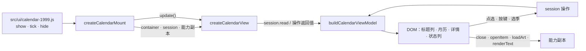
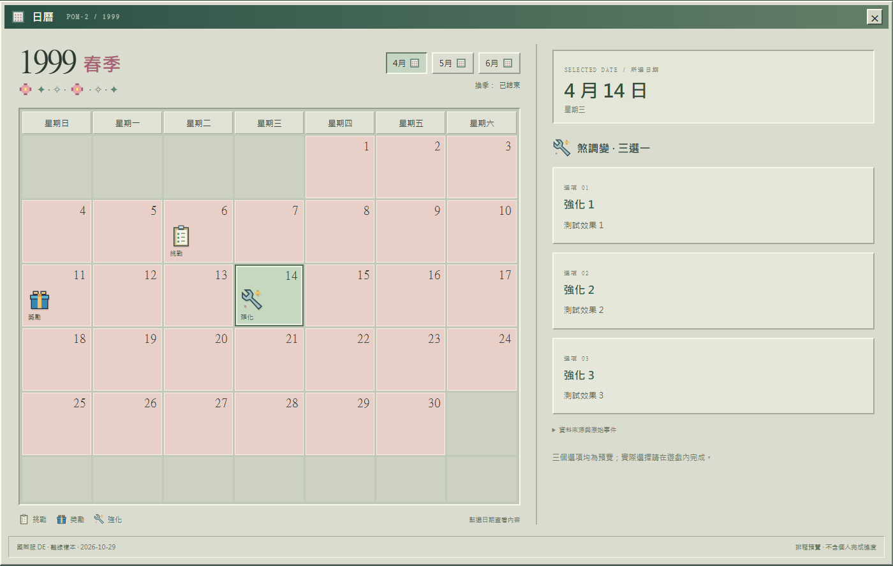
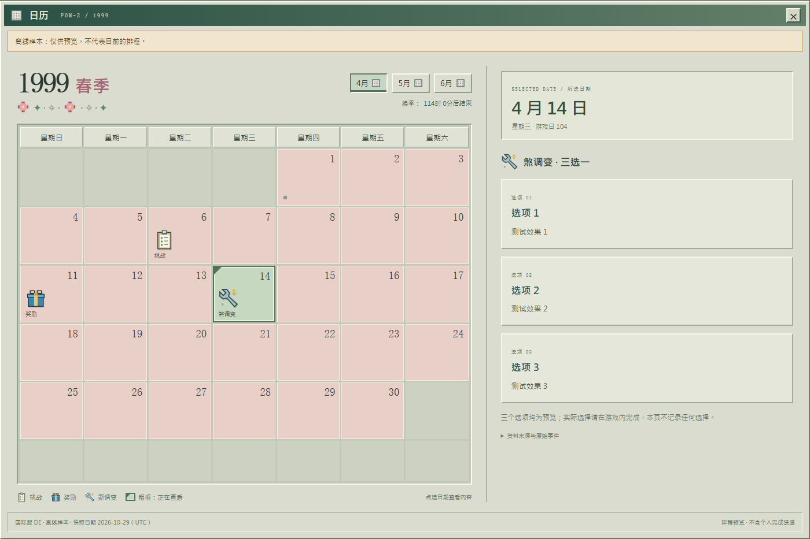
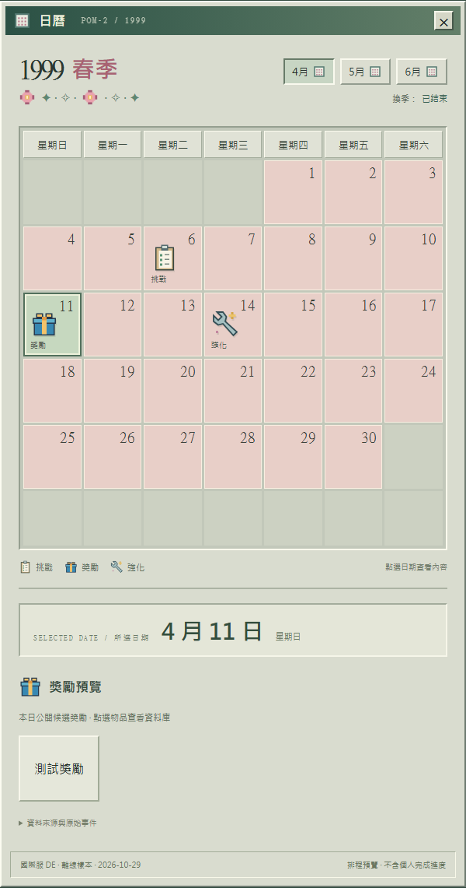
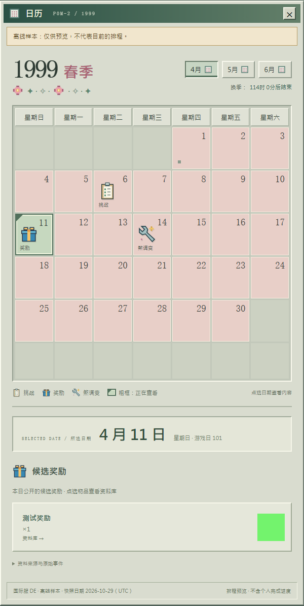
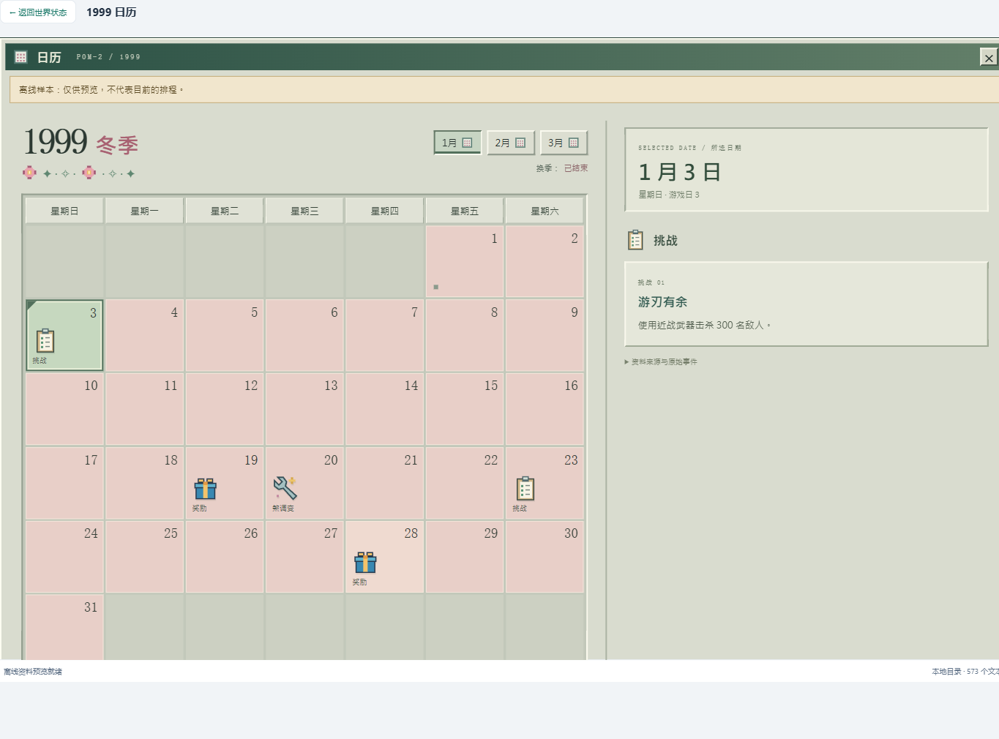

# 48 · 1999 日历画面重整与应用操作接入（CAL-08）

对应 Issue [#31 CAL-08：重整日历画面并接入应用操作](https://github.com/Dreamsunqing/1020-pbex-wfcd-zlk/issues/31)，依据 [#11](https://github.com/Dreamsunqing/1020-pbex-wfcd-zlk/issues/11) 的分层、[41 · 架构决策与契约](41-1999日历架构决策与契约.md) 的 ADR-003／005／006／007／008／009，承接 [46 · HANDOFF-01](46-1999日历核心阶段完成度查核.md#四需求决定与已接受限制) 与 [47 · 第十节第 1、3 项](47-1999日历App能力转接与组装入口.md#十已知限制与交接)。

目标：画面只负责呈现与互动，沿用 MVP 原型（复古桌面月历，未纳入本仓库）的视觉与操作。日期、选取与分类规则全部留在会话与视图模型；画面只经 CAL-07 的能力副本接触宿主。独立执行页面属 CAL-09（#32），架构检查器与 CI 属后续阶段。

## 一、范围

- 分支 `refactor/31-calendar-presentation-and-application-integration`，基于 `914ac44`（PR #33 合并后的 `refactor/11-calendar-1999-ui-mvp`）。
- 本次新增与修改：

| 文件 | 层 | 内容 |
|---|---|---|
| `src/features/calendar-1999/presentation/calendar-view.js` | presentation | 新增 `createCalendarView`：`CalendarViewFactory` 的原生 DOM 实现 |
| `src/features/calendar-1999/presentation/icons.js` | presentation | 代码绘制的像素图标，元素由容器所属文档建立 |
| `src/features/calendar-1999/presentation/calendar.css` | presentation | 全部规则限定在 `.cal99`；容器查询负责窄容器排列 |
| `src/features/calendar-1999/index.mjs` | 公开入口 | 导出 `createCalendarView` |
| `src/ui/calendar-1999.js` | 宿主组装入口 | `view` 默认改为 `createCalendarView`；`null` 仍保留旧卡片 |
| `src/ui/index.html` | 宿主 | 链接 `../features/calendar-1999/presentation/calendar.css` |
| `src/ui/live-state.js` | 宿主 | 只更新注释；调用点与 CAL-07 相同 |
| `test/calendar/presentation.test.mjs` | 测试 | 11 项静态检查：依赖、全局与计时器、规则不外漏、`update()` 与滚动、类型不推测、能力、文案、CSS |
| `test/calendar/composition.test.mjs`、`contracts.test.mjs` | 测试 | 默认画面注入、样式表链接；公开入口加入 `createCalendarView` |
| `scripts/check-calendar-ui.mjs`、`test/calendar/browser/harness.*` | 浏览器检查 | Chromium 中的 20 项检查与对照截图，见第十节 |
| `scripts/check-calendar-app-ui.mjs` | App 整合检查 | Electron 中的 11 项检查，见第九节 |
| `scripts/check-world-state-ui.mjs` | 既有 Electron 检查 | 日历详情步骤改为检查新画面（该脚本在日历之前就停止，见第十一节） |
| `文档/图示/1999日历-对照-*.png`、`1999日历-App整合-国际服.png` | 文档 | 基准与新画面对照、App 内截图，见第八节 |

## 二、画面与数据流

- 画面只用两样东西：`session` 的五个操作与能力副本。`CalendarState` 只交给 `buildCalendarViewModel`，画面不读它的字段（ADR-008）；焦点目标也从新模型取得。
- 元素由 `container.ownerDocument` 建立，不碰全局 `document`；挂载时不量测布局，所以容器尚未连入文档也能挂载（`ports.mjs` 的要求）。
- 同一个容器再次挂载时，先销毁旧画面（`CalendarViewFactory` 的要求）；配合 mount 的「一次只挂一个」，重复开启不会叠加画面。
- 监听器只有根元素上的 `click`、`keydown`、`change` 与捕获阶段的 `toggle` 四个；`destroy()` 移除它们与根元素，可重复调用。

## 三、移出画面的规则（相对 MVP 原型的修正）

| MVP 原型（原 `presentation/calendar-view.js`）的做法 | CAL-08 |
|---|---|
| 直接读 `session.read()` 的 `month.days`，自己以 `days[0].weekday` 排 42 格 | 只画视图模型的 `grid.cells`；不做星期运算、不知道月份长度 |
| 以 `day === selected` 判断选取，空季度时读 `selected.kind` 会出错 | 只看模型的 `selected` 与 `selectedDay`；没有选取时显示「尚未选择日期」 |
| 方向键后读 `session.read().selected.ordinal` 决定焦点 | 按键交给 `session.move`，焦点取自新模型的 `selectedDay` |
| 未知季节直接 `return`，连季度选单都不画，无法切到其他季度 | 保留标题、季度选单与倒数，按原始顺序列出全部未映射事件 |
| 奖励、倒数靠宿主注入 `renderRewards`、`renderTime` 并沿用 `.ws-loot`、`.ws-time` | 画面自己画奖励卡与倒数，只经 `loadArt`、`openItem`、`formatDeadline`、`now` |
| 每次互动整页重画，倒数刷新也一样 | 选取改变才重画；时间推进时 `update()` 只更新倒数 |

画面里没有日期、季度、选取或分类规则；静态测试检查画面不出现星期运算、42 格、月份表、`buildSeasonMonths` 等，也不自行判断方向键。

## 四、互动、焦点与键盘

| 操作 | 会话调用 | 画面结果 |
|---|---|---|
| 点日期、对日期按 Enter／Space | `selectDay(ordinal)` | 重画，焦点留在该日期 |
| 方向键、Home、End | `move(key)`，返回 `false` 时不处理 | 重画，焦点移到新选取的日期并保持可见；跨月时月份按钮同步 |
| 点月份 | `selectMonth(index)` | 重画，焦点留在月份按钮；日期清空 |
| 选季度 | `selectSeason(index)` | 重画，焦点留在季度选单 |
| 点奖励卡 | 无（`openItem(ref)`） | `true` 由宿主接手；`false` 在详情显示「资料库暂时无法打开「名称」。」（`role=status`） |
| 点 × | 无（`close()`） | 由宿主卸载 |

- **焦点保持可见**：用户操作后的新焦点先以 `focus({preventScroll: true})` 取得，再以 `scrollIntoView({block: 'nearest', inline: 'nearest', behavior: 'instant'})` 带进每一层滚动容器。`nearest` 对已经可见的日期不移动画面，对超出范围的日期只移动必要的距离。目标日期（含跨月）仍由 `session.move()` 决定，画面只负责焦点与可见性。
- **单一 Tab 停留点**：选取的日期 `tabindex=0`，没有选取时为当月第一天，其余为 `-1`；进入月历后用方向键移动。
- **点选与键盘一致**：两者走同一个会话操作与同一次重画；浏览器检查逐项比对 `aria-pressed`、详情文字与焦点。
- **选取不只靠颜色**：`aria-pressed`、2px 粗框（其他为 1px）、内框与左上角角标；月份按钮是按下的斜面加底部内条。图例写明「粗框：正在查看」。
- 详情区以日期标题 `aria-labelledby` 命名，内容更新后仍读作「4 月 14 日」的详情；标题下方同时写出星期与游戏日。日期按钮的无障碍名称包含日期、星期、事件类型与同日笔数。

### `update()` 与公开契约

`CalendarViewHandle.update()` 的契约（`ports.mjs`）是「只依目前会话重绘，不读取新数据，也不改变选取」。实作依会话现况分两种情况：

| 情况 | `update()` 的行为 |
|---|---|
| 会话选取未变，只有时间推进（宿主 30 秒时钟） | 只刷新倒数文字与状态；不重建 DOM、不滚动、不移动焦点，已展开的来源面板保持 |
| 会话的季度、月份或日期在画面以外被改变 | 依会话重画日期格、月份按钮、季度与详情；不滚动。焦点原本在日历内时，移到新 DOM 中扮演同一角色的元素（日期格移到当月停留点、月份按钮按序号、季度选单、来源面板标题、奖励卡），找不到时退到停留点或关闭键；焦点在宿主时不移动 |

- 判断依据是视图模型显示的选取（季度序号、月份序号、日期）。同一会话的文档冻结不变，只有选取会变，所以选取相同即画面相同。
- `update()` 只调用 `session.read()`，不调用任何操作，所以不改选取、不写存储、不重读来源、不建立计时器；`destroy()` 之后调用没有作用。

## 五、状态画面（承接 HANDOFF-01）

| 状态 | 画面 |
|---|---|
| 空资料（没有季度） | 保留标题列与状态列，显示「这份快照没有可用的 1999 日历。」 |
| 未知季节（模型没有 `grid`） | 保留标题、季度选单与倒数；提示「这个季度（代码）还没有日期对应规则」，按原始顺序列出全部事件，含奖励、条款与来源 |
| 本季有未映射事件 | 详情底部的可展开面板「N 笔事件的日期无法对应本季，已原样保留」，逐笔显示原始日序（缺失时写「缺失」） |
| 只列出、没有事件的日子 | 日期格左下小方块；详情「上游列有这个日期，但没有提供事件内容。」 |
| 未列出的日子 | 详情「这份快照未在这一天列出事件，请选择有图示的日期查看。」不推定为生日或任何事件 |
| 同日多笔独立条目 | 日期格右下「×N」；详情「N 笔事件」，逐笔以「事件 01 · 类型」列出，各自的条款、说明与来源面板 |
| 单笔混合条目（`mixed`，一个投影日含不同来源事件） | 不显示条目标题与「×N」；条款编号为「内容 01」等，不称为「选项」；条款后显示条件式说明（第七节） |
| 缺图、坏图、图片未到 | 奖励卡右侧以代码绘制的奖励图标占位，名称与跳转照常；坏的 data URL 由 `onerror` 退回占位 |
| `libraryId` 为 `null` | 不显示跳转，卡片写「资料库未收录」。CAL-10 起仍按完整 ID 请求图片：宿主有映射图时显示图片，否则为占位图标（HANDOFF-01 的占位策略），见 [50 · 第四节](50-1999日历奖励图片映射.md#四取图与资料库跳转分开) |
| 过期、样本、导入快照 | 标题列下方提示列：过期为「快照已过期：以下是快照当时的排程，目前可能已经改变。」；样本、导入各有说明。实时快照不显示 |
| 外部操作失败 | `openItem` 返回 `false` 时显示状态讯息；`loadArt` 失败一律为占位图 |

- 完整物品 ID 不因画面简化而遗失：奖励卡的 `title` 与 `data-item-id` 是完整 ID，来源面板另列「完整物品 ID」与原始事件 JSON。
- 「同日多笔独立条目」与「单笔混合条目」是两种资料：前者是多个 `CalendarEntry` 落在同一天（日期格为 `mixed`，每笔条目保留自己的类型）；后者是一个 `CalendarEntry` 的 `kind` 就是 `mixed`（转接器把同一投影日的 `CET_REWARD` 与 `CET_UPGRADE` 合成一笔）。`TermRef` 没有类型字段，画面不从名称、文字或 `evidence` 推测条款属于哪一类（静态测试检查）。

## 六、CSS 作用范围与窄容器

- `calendar.css` 的每个选择器都以 `.cal99` 开头，不含 `#id`、`:root`、`html`、`body` 或 `.ws-*`；只有 `[hidden]` 使用 `!important`；唯一的 at-rule 是 `@container`。静态测试逐条检查，浏览器检查再以 CSSOM 核对。
- 后代规则一律写成 `.cal99 .x`（两个类），权重高于 App 的 `.ws-page svg`、`button` 等元素规则，App 样式不会改变日历图标与按钮尺寸。
- `.cal99` 重新定义 `--text`、`--line`、`--surface` 等 App 变量，只作用于日历子树，让 App 的全局按钮、选单与游戏文字在日历内变成浅色；App 本身不受影响（App 检查比对打开日历前后的快速入口按钮样式）。
- MVP 放在功能 CSS 里的 `#world.ws-calendar-mode …`（打开日历时压缩世界状态页头）已移除：它是宿主版面，会影响其他功能。若仍需要，应放在 `live-state.css` 并由宿主切换。
- 窄容器按日历自身宽度（`container-type: inline-size`）：≤930px 上下排列，≤560px 精简日期格与月份按钮。宽度来自容器而不是视窗，所以日历放在窄栏里也会正确排列。
- 样式表由宿主页面链接（`src/ui/index.html`）；画面不往文档插入样式。CAL-09 的独立页面同样直接链接这个文件。

## 七、文案决定

- **语言**：App 介面是简体中文，日历在 App 内一律用简体（MVP 原型为繁体）。这回答了 [41 · 未决问题第 1 项](41-1999日历架构决策与契约.md#七未决问题) 在日历画面的部分；其他介面的语言统一不在本章范围。
- **类型名称**：`challenge` 挑战、`reward` 候选奖励、`upgrade` 煞调变 · 三选一（ADR-005）、`mixed` 综合事件、`other` 其他事件。MVP 的「待办挑战」改为「挑战」，避免暗示个人待办。
- **条款编号**：挑战条目为「挑战 NN」，煞调变条目为「选项 NN」，其余（含混合条目）为「内容 NN」。
- **条款后的说明**：
  - 纯 `upgrade` 条目：「三个选项均为预览；实际选择请在游戏内完成，本页不记录任何选择。」
  - `mixed` 条目：「此处仅预览公开事件。若包含煞调变，候选效果以游戏内三选一为准；本页不记录个人选择或完成进度。」这句是条件式的，不把混合条目说成强化，也不把其中的条款当成同一组选项。
  - 其他类型不显示说明。说明以条目自己的 `kind` 决定，不看日期格的类型，所以多笔独立条目的日子不会出现混合说明。
- **不暗示个人进度**：奖励一律称候选；状态列固定显示「排程预览 · 不含个人完成进度」；选取称「正在查看」，不使用已完成、已领取、已解锁、已选择、今天等字词（静态测试检查）。
- 旧卡片（`card-states.mjs`）的「强化日 · 三选一」未改：新画面成功显示时旧卡片详情不出现，只在回退时出现；统一旧卡片文案留待移除旧详情时处理。

## 八、与基准画面的对照

**资料与条件**：两边都用同一份春季资料（MVP 侧为原型夹具，新画面侧为 `test/calendar/fixtures/contracts/valid-document.json`，DE 离线样本，4 月 6 日挑战、4 月 11 日奖励、4 月 14 日三选一），Chromium、`deviceScaleFactor` 1，截取 `.cal99` 元素，鼠标移开以避免悬停色。

| 对照 | 容器宽度 | 所选日期 | 版面 |
|---|---|---|---|
| 宽版 | 1400px | 4 月 14 日（煞调变 · 三选一） | 左月历、右详情 |
| 窄版 | 600px | 4 月 11 日（候选奖励） | 上下排列、精简日期格 |

**来源与重现**：MVP 基准图是 2026-11-01 以原工作目录中未纳入版本控制的 MVP 原型（`src/features/calendar-1999/presentation/*` 与 `test/calendar/browser/fixture.html`）截取，该原型不在本仓库，所以基准图以档案冻结保存。CAL-08 的同条件截图由 `node scripts/check-calendar-ui.mjs` 的对照步骤重新产生，位于 `artifacts/calendar-ui/compare-new-{wide,narrow}-{104,101}.png`。本次不建立自动像素比对。

版面、配色、格线、图标、字级与窄容器排列一致；以下为预期差异：

| 差异 | 原因 |
|---|---|
| 标题列下方多一条快照提示 | 过期快照不得包装成目前排程（#11、HANDOFF-01） |
| 文字改为简体，「强化」改为「煞调变」 | 第七节 |
| 选取日期多一个左上角标，图例多「粗框：正在查看」 | 选取状态不只靠颜色 |
| 只列出、没有事件的日子多一个小方块（4 月 1 日） | HANDOFF-01 的「只列出」画面处理 |
| 详情副标多「游戏日 N」 | 右侧更新后仍能对照上游日序 |
| 三选一说明移到来源面板之前，并加「本页不记录任何选择」 | 说明紧接在选项后；不暗示个人进度 |
| 奖励卡由画面自行绘制（外观沿用 MVP 在 App 内的 `.cal99 .ws-loot` 覆写），右侧显示图片或占位 | 不再依赖宿主的 `loot()` 与 `.ws-*` 样式；MVP 夹具的奖励只是纯文字按钮 |
| 倒数显示实际剩余时间，MVP 夹具固定为「已结束」 | 新画面经 `formatDeadline` 与 `now()` 计算 |
| 状态列写「快照日期 YYYY-MM-DD（UTC）」 | 标明日期为 UTC |

## 九、宿主接入与 App 证据

- `createCalendar1999Host` 的 `view` 默认为 `createCalendarView`，所以 App 打开「1999 日历」详情（快速入口或总览的「完整内容」）时显示新画面。传 `view: null`、投影无法转换或画面挂载失败时，`show()` 返回 `false`，`live-state.js` 照旧显示旧卡片。
- `live-state.js` 的调用点与 CAL-07 完全相同（`show`、`tick`、`hide`），本次只更新注释。

**可重跑的 App 检查**：`node scripts/check-calendar-app-ui.mjs`（Electron，内置 DE／WG 离线样本，约 2 分钟，含一次真实的 30 秒宿主时钟；报告与截图在 `artifacts/calendar-app-ui/`）。检查期间会开启 App 视窗，请勿操作，人工点击会改变选取并使检查失败。11 项：

1. 快速入口打开新日历，旧卡片详情不出现；1—3 月共 15 个事件日，首选 1 月 3 日；离线样本提示；功能样式表已由 `index.html` 载入。
2. 煞调变日经 App 的 `renderGameText` 显示三项名称与说明，并保留三选一说明。
3. 620px 高的窗口中以方向键、Home／End 跨月移动，焦点日期始终在世界状态页（`#world`）的滚动区域内可见。
4. 宿主 30 秒时钟（`updateTimes → tick → update`）刷新倒数时，日期格未重建，焦点与滚动位置不变。等待期间若宿主重绘（例如仲裁资料到达）会重新挂载，检查会计数并改为观察新画面；2026-11-01 的通过记录中为 0 次。
5. 奖励以 Enter 打开资料库，返回后日历恢复原日期。
6. 宿主 `render()` 重绘后，经共用存储恢复选取，页面只有一个日历。
7. 深色主题下日历维持浅色桌面；800px 窗口上下排列且无水平溢出。
8. × 经 `close` 能力回到世界状态，日历卸载；快速入口按钮样式与打开日历前相同。
9. 总览卡片仍只显示奖励；「完整内容」进入新日历，返回键回到总览。
10. 国服显示自己的日历与状态列。
11. 无页面错误，网页进程无外网请求。

- CAL-07 issue 中尚未勾选的「注入图片及游戏文字处理能力」「定义挂载、更新与卸载流程」「处理非同步结果晚于卸载的情况」「卸载后不再更新旧画面」，在 [47](47-1999日历App能力转接与组装入口.md) 已以单元测试验收；本次以真实画面再验证：浏览器检查覆盖卸载后旧画面不再操作会话、未完成图片卸载后不报错、`update()` 的两种情况、全程不建立计时器；App 检查覆盖真实 `renderGameText`、`api.images`、资料库跳转、宿主时钟与重绘恢复。

## 十、验收对照（Issue #31）

浏览器检查（`node scripts/check-calendar-ui.mjs`，Chromium，测试夹具，假能力）按输出顺序共 20 项，下表以「B编号」引用：B1 宿主投影冬季；B2 日期、奖励、图片、资料库与来源；B3 键盘、焦点与点选一致；B4 焦点日期可见（短窗口、窄容器、内部滚动容器）；B5 选取不只靠颜色；B6 月份与季度；B7 新快照恢复与过期提示；B8 同日多笔独立条目；B9 单笔混合条目；B10 未映射、未知季节、无事件季度、空快照；B11 缺图与无资料库目标；B12 长文字；B13 窄容器；B14 外部操作失败与关闭；B15 时间推进的 `update()`；B16 会话外部改变后的 `update()`；B17 卸载与计时器；B18 样式作用范围与深色宿主；B19 对照截图；B20 只请求日历自己的文件。App 检查以「A编号」引用第九节的 11 项。

| 工作项目 / 验收条件 | 实作 | 证据 |
|---|---|---|
| 移出画面内的日期与选取规则 | 第三节 | `presentation.test.mjs`：`presentation keeps no calendar rule…`；B3、B4 |
| 使用应用层提供的画面模型 | `buildCalendarViewModel` 是唯一读取状态之处 | `presentation.test.mjs`；B16 |
| 保留季度、月份与日期格 | 季度选单、三个月份按钮、42 格 | B1、B6、A1 |
| 保留右侧事件详情 | 详情区 | B2、B8、B9、A2 |
| 保留候选奖励与三选一说明 | 奖励卡、「煞调变 · 三选一」与预览说明；混合条目的条件式说明 | B2、B8、B9、A2 |
| 保留来源查看 | 每笔条目的来源面板、未映射面板 | B2、B10 |
| 整理 CSS 作用范围 | 第六节 | `presentation.test.mjs` 的三项 CSS 检查；B18；A8 |
| 保留窄容器排列 | 容器查询 930／560px | B12、B13、A7 |
| 完成焦点与键盘操作 | 第四节 | B3、B4、B6、B16、A3 |
| 处理空资料、未知季节及缺图状态 | 第五节 | B10、B11 |
| 外观与基准画面没有非预期差异 | 第八节 | 对照截图与预期差异表；B19 |
| 点选与键盘操作结果一致 | 同一会话操作与同一次重画 | B3 |
| 选取状态不只靠颜色表达 | `aria-pressed`、粗框、内框、角标 | B5 |
| 右侧内容更新后仍可理解所选日期 | `aria-labelledby` 日期标题、星期与游戏日 | B2、B3、B16 |
| 长文字不溢出或被静默截断 | `overflow-wrap: anywhere`、标题可换行 | B12（1400／820／500px） |
| CSS 不影响其他 App 功能 | 第六节 | B18；A8 |
| 画面中不存在个人进度的错误暗示 | 第七节 | `presentation.test.mjs`：`wording never suggests personal progress…`；B9 |

**回归有效性（变异验证）**：2026-11-01 把三处修正分别暂时还原成旧行为并重跑浏览器检查，每一处都在对应项失败，改动随后还原：

| 还原的行为 | 失败位置 |
|---|---|
| 键盘移动后不把焦点日期带进可见范围 | B4「短窗口 ArrowDown → 98」 |
| `update()` 只刷新倒数、不反映会话 | B16（日期格仍显示旧选取） |
| 混合条目不显示条件式说明 | B9 |

## 十一、验证

2026-11-01，Windows 11、Node v24.12.0、Playwright 1.64.1、Electron 44.9.0，分支 `refactor/31-calendar-presentation-and-application-integration` 的工作树（未提交）：

| 状态 | 验证 | 结果 |
|---|---|---|
| 已通过 | `node --test test/calendar/*.test.mjs` | 104／104 通过（CAL-07 基线 92 项，新增 12 项） |
| 已通过 | `node scripts/check-calendar-ui.mjs` | 20／20 通过，无页面错误，只请求 19 个日历相关文件 |
| 已通过 | `node scripts/check-calendar-app-ui.mjs` | 11／11 通过，无页面错误、无外网请求；等待时钟期间宿主重绘 0 次 |
| 已通过 | `npm run check` | 语法检查 243 个文件通过 |
| 已通过 | 变异验证 | 第十节，三处修正各自被对应检查拦截 |
| 既有失败（与基线相同） | `npm test` | 341 项：334 通过、7 失败。其中 6 项在 [44 · 第十一节第 5 项](44-1999日历应用操作流程.md#十一审查待办与验收条件) 记录的 Windows 环境问题之内（4 项符号链接 `EPERM`、1 项路径反斜线、1 项合并说明 CRLF）；第 7 项为 `wiki-archive.test.mjs` 的「site minimum beyond ten seconds…」计时断言，单独重跑 3 次均 14／14 通过，属全量负载下的偶发失败，相关文件本次未改动。基线中的 `inline-tokens.test.mjs` 本次通过，原因不在本章范围 |
| 既有失败（与基线相同） | `node scripts/check-world-state-ui.mjs` | 仍在第二步统计数量处失败（预期 14、实际 15），在日历步骤之前停止，**不能**作为本次日历整合的证据；日历的 App 证据为 `check-calendar-app-ui.mjs` |

**图片验证分开记录**：

| 路径 | 方式 | 结果 |
|---|---|---|
| 图片「找到」与显示 | 浏览器检查以假 `loadArt` 返回 1×1 data URL（B2） | 已通过：奖励卡显示 `` |
| 缺图、坏图、图片未到、无资料库目标 | 浏览器检查（B11） | 已通过：占位图标，名称与跳转保留 |
| App 经 `api.images` 取图 | App 检查（A5） | 请求经真实桥接完成；本机没有图库（`assets/content` 不存在），结果为占位图 |
| App 内真实图库的图片显示 | — | **未验证**：需要有图库的环境重跑 A5，并确认 `facts.rewardPicture` 为 `found` |

## 十二、完成范围与未支援

**本次完成**：

- 原生 DOM 画面 `createCalendarView`、像素图标与限定作用范围的样式表，并接入 App 组装入口与页面样式表。
- 季度、月份、日期格、右侧详情、候选奖励、三选一与混合条目说明、来源查看、快照状态提示与全部空／缺状态。
- 键盘操作、单一 Tab 停留点、焦点跟随与可见、点选与键盘一致、选取不只靠颜色。
- `update()` 依会话现况重画或只刷新倒数，符合 `ports.mjs` 的既有契约。
- 窄容器排列、长文字换行、CSS 不影响 App。
- 静态测试、Chromium 浏览器检查、Electron App 检查、对照截图与变异验证。

**仍未支援**：

1. **跨快照的焦点恢复**：宿主每次 `render()` 都 `hide()` 再 `show()`（47 · 第十节第 2 项），新画面经存储恢复选取，但焦点、已展开的来源面板与滚动位置不保留。只有宿主时钟的 `tick()` 与会话外部改变后的 `update()` 会保留或转移焦点。App 中仲裁资料到达、刷新、切换服务器都会触发重绘。
2. **混合事件细项分类**：`TermRef` 没有类型字段，单笔混合条目的条款无法逐项标示为挑战或煞调变；画面只显示条件式说明。需要扩充契约（HANDOFF-01）。
3. **图片**：只按 `libraryId` 取图，单层图片（2026-11-06 CAL-10 起先查奖励图片映射，无资料库目标的奖励也请求图片，见 [50](50-1999日历奖励图片映射.md)）；`iconToken` 占位仍用代码图标，不读 App 的文字图标库；App 内真实图片未验证（第十一节）。
4. **世界状态页头**：打开日历时不再压缩世界状态页头（第六节），若需要应由宿主样式承接。
5. **旧卡片文案**：`card-states.mjs` 仍为「强化日 · 三选一」，只在回退时可见（第七节）。
6. **CAL-09**：浏览器检查的夹具只供自动检查，不是可操作的独立页面；独立页面、假能力控制、情境切换与启动指令由 #32 建立，可复用 `harness.mjs` 的情境与 `check-calendar-ui.mjs` 的限定文件服务方式。2026-11-01 CAL-09 承接：独立页与启动指令 `npm run calendar:standalone` 已建立；夹具改用共用的 `scenarios.mjs`、`fake-capabilities.mjs` 与 `fixtures/scenarios/`，文件服务改用 `pageFileOf`，20 项检查不变，见 [49](49-1999日历独立执行页面与测试资料.md)。
7. **CI**：两个检查脚本需要 Playwright 的 Chromium 与 Electron，尚未接入 GitHub Actions，留给 CI 阶段。
