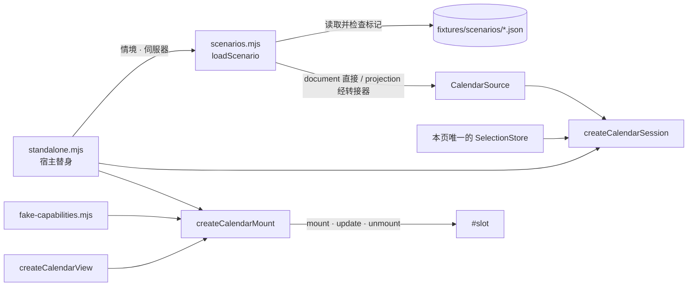

# 49 · 1999 日历独立执行页面与测试资料（CAL-09）

对应 Issue [#32 CAL-09：建立独立执行页面与测试资料](https://github.com/Dreamsunqing/1020-pbex-wfcd-zlk/issues/32)，依据 [#11](https://github.com/Dreamsunqing/1020-pbex-wfcd-zlk/issues/11) 预计目标第 4 项（日历可以使用小型固定资料独立执行）、[41 · 架构决策与契约](41-1999日历架构决策与契约.md) 的 ADR-001／005／007／009，承接 [48 · 第十二节第 6 项](48-1999日历画面重整与应用操作接入.md#十二完成范围与未支援)。

目标：维护者不用启动整个 App，也能开发日历画面。独立页面不需要 Electron、完整上游资料包、内置大型 gzip 或图库、实时 API 与游戏帐号，并且不会被误认为正式排程。架构检查器与 CI 属后续阶段。

## 一、范围

- 分支 `test/32-calendar-standalone-harness-and-fixtures`，基于 `aabaad3`（PR #34 合并后的 `refactor/11-calendar-1999-ui-mvp`）。
- 日历功能本身（`src/features/calendar-1999/`）与 App（`src/ui/`、`src/core/`）都没有修改。

| 文件 | 内容 |
|---|---|
| `scripts/serve-calendar-standalone.mjs` | 新增：本机测试伺服器与 `pageFileOf` 文件范围规则；只用 Node 内置模块 |
| `package.json` | 新增启动指令 `calendar:standalone` |
| `test/calendar/browser/standalone.html`、`standalone.css`、`standalone.mjs` | 新增：独立测试页（宿主替身、控制项、操作纪录、选取存储面板） |
| `test/calendar/browser/scenarios.mjs` | 新增：14 个情境的目录与载入器，独立页、浏览器检查夹具与单元测试共用 |
| `test/calendar/browser/fake-capabilities.mjs` | 新增：六项外部能力的假实作与失败模式，独立页与夹具共用 |
| `test/calendar/fixtures/scenarios/*.json` | 新增：10 个固定测试资料，每个都标示为测试用途 |
| `test/calendar/browser/harness.mjs` | 改用共用情境与假能力；`window.calendarHarness` 介面不变 |
| `scripts/check-calendar-ui.mjs` | 文件服务改用 `pageFileOf`；夹具范围收窄到 `fixtures/scenarios/`；20 项检查不变 |
| `test/calendar/standalone.test.mjs` | 新增：13 项单元测试（第八节以 U 编号引用） |
| `scripts/check-calendar-standalone-ui.mjs` | 新增：独立页的 Chromium 检查 12 项（第八节以 S 编号引用） |

## 二、启动与使用

```bash
npm run calendar:standalone
```

终端机印出 `http://127.0.0.1:1999/`，用浏览器打开即可，按 Ctrl+C 结束。端口被占用时：

```bash
node scripts/serve-calendar-standalone.mjs --port 0
```

`--port 0` 由系统选择可用端口，终端机印出实际网址。

**需要**：Node 22.19 以上（`package.json` 的 `engines`）。伺服器只用 Node 内置模块，不需要先 `npm install`；页面需要支援 JSON 模块（`import … with { type: 'json' }`）的浏览器，已验证 Playwright 内置的 Chromium 与 Claude 桌面版内置浏览器。

**不需要**：Electron、`node_modules`、`世界状态上游/` 资料包、`src/data/` 的 gzip 与生成资料、`assets/content` 图库、网络与游戏帐号。S1 把伺服器脚本与允许范围复制到空的暂存资料夹（32 个文件，约 186 KiB）后直接启动，证明以上都不需要。

### 控制项

| 区块 | 控制 | 作用 | 对应 App 行为 |
|---|---|---|---|
| 资料 | 情境 | 换一个情境：重建来源与会话再挂载，并套用情境的预设能力与时钟 | 新快照到达时重建会话（ADR-007） |
| 资料 | 伺服器 | 国际服 DE／国服 WG：重建来源与会话；两服的选取分开保存 | 切换伺服器 |
| 假外部能力 | 图片（`loadArt`） | 找到、缺图、坏图、一直载入、1.5 秒后找到、请求失败；改变后重新挂载以重新取图。CAL-10 起每个奖励（含无资料库目标者）都会请求，纪录为 `['loadArt', id, libraryId]`，所选模式对所有奖励一视同仁 | `api.images`，以及 CAL-10 的奖励图片映射（[50](50-1999日历奖励图片映射.md)） |
| 假外部能力 | 角色图（`loadPortrait`） | 找到（测试图写出资源键）、缺图、坏图、请求失败；改变后重新挂载。网址参数 `portrait`。CAL-11 新增，纪录为 `['loadPortrait', key]` | 角色图映射（[51](51-1999日历六人组生日与角色图.md)） |
| 假外部能力 | 资料库跳转（`openItem`） | 接受、不可用（返回 `false`）、抛错 | 打开资料库 |
| 假外部能力 | 关闭（`close`） | 正常（本页卸载日历，可重新打开）、抛错（日历留在原位） | 回到世界状态页 |
| 时钟 | 设为（UTC）、−1 天、+1 小时、+1 天、情境默认 | 改变假时钟后宿主调用 `update()`，只刷新倒数 | 宿主 30 秒时钟 `tick()`（ADR-009） |
| 宿主 | 主题 | 浅色／深色宿主（`body.dark`），日历应维持浅色桌面 | App 深色主题 |
| 宿主 | 日历容器宽度 | 自动、1400、900、600、500、360px；930px 以下上下排列，560px 以下精简日期格 | 窄栏 |
| 宿主 | 重新挂载（新快照）、重画 `update()`、卸载 | 分别模拟宿主 `render()`、`tick()`、`hide()` | `show`／`tick`／`hide` |
| 操作纪录 | — | 列出外部能力调用（含完整物品 ID）、被能力副本吸收的错误与本页的宿主动作 | — |
| 选取存储 | 清空并重新挂载 | 列出本页内存 `SelectionStore` 中每个 `contextId` 的选取；标出目前挂载的一笔 | 宿主共用的存储（HANDOFF-02） |

换情境、换伺服器、改图片模式、重新挂载或清空存储时，页面先卸载旧日历，在日历位置显示「正在载入「情境 · 伺服器」的测试资料…」，情境说明也先换成新情境并标示载入中；新资料到达后才挂载。载入期间没有可操作的日历，`update()` 返回 `false`。连续切换时只挂载最后一次的选择，较早而晚到的载入直接丢弃（S11）。

`renderText` 每个名称与说明都会调用一次，为免淹没其他纪录，不列入操作纪录。

### 网址参数

每个控制项都写入网址，可重新整理或分享：`scenario`、`server`、`art`、`open`、`close`、`now`（UTC 时间）、`theme`、`width`。例如：

```
/test/calendar/browser/standalone.html?scenario=long&server=wg&art=missing&width=600&theme=dark
```

网址的值优先于情境的预设值；无效值回退默认值并写入操作纪录。

## 三、页面结构与数据流



- 页面只经公开入口 `src/features/calendar-1999/index.mjs` 使用日历，与 App 的组装入口 `src/ui/calendar-1999.js` 用同样的五个导出：`createWorldStateCalendarSource`、`createCalendarSession`、`createMemorySelectionStore`、`createCalendarMount`、`createCalendarView`。U10 走访两个页面的静态导入图，确认没有其他路径。
- 页面就是宿主：它持有存储（整页一个，伺服器、季度与轮回靠 `contextId` 隔离）、时钟（假的，只有控制项会改）与节拍（时钟改变后调用 `update()`）。日历内部仍不建立计时器。
- 每次挂载先卸载旧画面再载入资料：页面标签与日历永远属于同一个情境与伺服器，不会出现新标签旁边还留着可操作的旧日历。挂载以序号（`ticket`）判断是否仍是最新的选择；卸载与关闭也会推进序号，所以载入中按卸载或关闭后，晚到的资料不会再挂上去。
- 样式表由页面链接：`harness.css`（CAL-08 的 App 全局元素规则替身）、`standalone.css`（本页外框）与功能的 `presentation/calendar.css`。两个宿主样式表都不含 `.cal99` 选择器（U11）。
- 页面的 CSP 只允许同源脚本、样式与 `data:` 图片；动态样式一律经 CSSOM 设定。

## 四、测试资料

### 格式与标示

每个文件都是：

```json
{
  "fixture": {
    "purpose": "test",
    "notice": "测试资料：只供 1999 日历独立测试页与浏览器检查使用，不是任何服务器的正式排程。",
    "description": "这份资料包含什么"
  },
  "document": { "…": "CalendarDocument" }
}
```

或以 `"projection"` 取代 `"document"`，放宿主世界状态投影（`buildWorldView` 的输出形状），由功能的转接器转换，与 App 走同一条路。

- `loadScenario` 只接受 `fixture.purpose` 为 `"test"`、且恰好有 `document` 或 `projection` 其一的文件；其他文件一律拒绝（U5）。页面因此不能被指向未标示的资料。
- 每个文件都以国际服写成，`data.kind`（或投影的 `kind`）一律为 `sample`，所以日历本身也显示「离线样本：仅供预览，不代表目前的排程。」（U3）。
- 单一文件小于 16 KiB，全部合计约 34 KiB；资料中唯一的网址是保留网域 `example.invalid`，只作长文字（U3）。

### 情境

| 情境 | 分组 | 文件 | 情境额外设定 |
|---|---|---|---|
| 正常冬季 | 正常排程 | `winter.json`（投影） | 时钟 2026-10-22 19:32 UTC |
| 正常春季 | 正常排程 | `spring.json` | — |
| 两个季度 | 正常排程 | `seasons.json` | — |
| 同日多笔独立条目 | 同日多事件 | `multi.json` | — |
| 单笔综合条目 | 同日多事件 | `mixed-entry.json`（投影） | — |
| 未知季节 | 边界与空资料 | `unknown-season.json` | — |
| 日期无法对应本季 | 边界与空资料 | `unmapped.json` | — |
| 季度没有事件 | 边界与空资料 | `quiet.json` | — |
| 空资料 | 边界与空资料 | `empty.json` | — |
| 缺图与长文字 | 边界与空资料 | `long.json` | 图片预设缺图 |
| 过期快照 | 快照状态 | `spring.json` | 快照改为 `network`、过期 |
| 导入快照 | 快照状态 | `spring.json` | 快照改为 `import`、过期 |
| 实时快照 | 快照状态 | `spring.json` | 快照改为 `network`、未过期 |
| 外部操作失败 | 外部操作 | `spring.json` | 图片请求失败、跳转抛错、关闭抛错 |
| 六人组生日 | 角色生日 | `birthdays.json`（投影） | 时钟 2026-10-22 19:32 UTC；CAL-11 新增 |
| 生日缺角色图 | 角色生日 | `birthdays.json`（投影） | 角色图预设缺图 |
| 生日来源冲突 | 角色生日 | `birthday-conflict.json`（投影） | 时钟 2026-11-10 06:00 UTC |

- 情境只能改写文件的快照状态（`data.kind`、`data.stale`），不能改季度或条目（U2）。同一文件的 `contextId` 不变，所以过期、导入、实时快照与春季共用选取，就是「同一季度的新快照」（ADR-005）。
- 没写时钟的情境用 2026-10-28 06:00 UTC，落在春季窗口内。时钟是假的，与现实时间无关。
- 情境的说明（页面上方「资料内容」与预期画面）写在 `scenarios.mjs` 的 `summary` 与文件的 `fixture.description`。

### 伺服器切换

测试资料以 DE 写成。选 WG 时，载入器只把 `data.server` 换成 `wg`，并把 `contextId` 开头的伺服器部分换掉（文件中的 `contextId` 一律以 `de:` 开头，U3）；投影则只换 `server`，由转接器自行产生新的 `contextId`。两服因此各有自己的 `contextId`，选取分开保存（U1、S3），但排程内容相同，不代表两服实际排程一致。

### 来源

10 个文件由 CAL-08 浏览器检查夹具原本在程式里组出的情境固化而来，内容相同，只有三处调整：`contextId` 改以伺服器开头（例如 `multi` 改为 `de:multi`）；`multi.json` 中移到 4 月 11 日的两笔条目，`evidence.day` 改为 101，与日序一致；`unknown-season.json` 改为国际服离线样本（契约范例 `valid-unmapped-entry.json` 为国服实时快照）。`check-calendar-ui.mjs` 改用这些文件后 20 项全部照常通过，证明画面结果没有改变。契约范例 `fixtures/contracts/` 与转接器测试的 `fixtures/world-state/` 没有修改。

### Issue #32 的测试情境

| Issue 情境 | 本页情境 |
|---|---|
| 正常冬季 | 正常冬季 |
| 正常春季 | 正常春季（另有两个季度） |
| 同日多事件 | 同日多笔独立条目、单笔综合条目 |
| 未知季节 | 未知季节（另有日期无法对应本季） |
| 空资料 | 空资料、季度没有事件 |
| 缺图与长文字 | 缺图与长文字 |
| 过期快照 | 过期快照（另有导入、实时快照） |
| 外部操作失败 | 外部操作失败；另可对任何情境切换图片、跳转、关闭的失败模式 |

## 五、本机测试伺服器的文件范围

规则（`scripts/serve-calendar-standalone.mjs`）：

- 只在 `127.0.0.1` 监听；只回应 `Host` 为 `127.0.0.1:端口` 或 `localhost:端口` 的请求，其他一律 403，避免别的网站以 DNS 重新绑定读取本机文件。
- 只接受 GET 与 HEAD，其他 405。`/` 302 转到独立页；没有目录列表。
- 路径必须是纯 ASCII（字母、数字、`.`、`_`、`-`、`/`），没有空段、`.`、`..` 或以点开头的段；不解百分号编码，所以 `%2e%2e`、`..%2F` 都到不了文件系统。
- 扩展名只限 `.html`、`.mjs`、`.js`、`.css`、`.json`，并且位于以下三个资料夹之一：`src/features/calendar-1999/`、`test/calendar/browser/`、`test/calendar/fixtures/scenarios/`。
- 依实际路径（解开符号链接与目录连接）再确认一次仍在这三个资料夹内，并且是文件。
- 其余一律 404，回应内容只有 `Not found`，不透露文件是否存在；每次拒绝都在终端机印出一行原因，方便发现页面想读范围外的文件。
- 所有回应都带 CSP（含 `frame-ancestors 'none'`）、`X-Content-Type-Options: nosniff`、`Cache-Control: no-store`、`Referrer-Policy: no-referrer`、`X-Robots-Tag: noindex, nofollow`。

| 请求 | 结果 |
|---|---|
| `/` | 302 → `/test/calendar/browser/standalone.html` |
| 日历功能、测试页、情境资料 | 200 |
| `/package.json`、`/src/ui/index.html`、`/src/ui/calendar-1999.js`、`/src/data/void-storm-history.json.gz` | 404 |
| `/test/calendar/fixtures/contracts/…`、`/scripts/serve-calendar-standalone.mjs` | 404 |
| `…/../../../package.json`、`…/..%2F..%2Fpackage.json`、`…/%2e%2e/…` | 404 |
| 允许资料夹内指向外部的目录连接 | 404 |
| POST | 405 |
| `Host: calendar.example:端口` | 403 |

`scripts/check-calendar-ui.mjs` 以同一个 `pageFileOf` 决定假来源回应哪些文件，所以 CAL-08 的检查页与独立页看到的文件范围相同。

## 六、不被误认为正式排程

| 层次 | 做法 |
|---|---|
| 页面标题 | 「1999 日历独立测试页（测试资料，非正式排程）」 |
| 横幅 | 页首固定的斜纹横幅：「测试页面 · 本页只使用固定测试资料与假外部能力；日期、奖励与倒数都不是任何服务器的正式排程，也不含个人进度。」捲动时仍可见 |
| 框线 | 日历外的虚线框标着「测试资料 · 情境 · 伺服器 · 不是正式排程」 |
| 情境说明 | 列出资料文件路径与 `fixture.notice` |
| 资料本身 | 每个文件带 `fixture.purpose: "test"`，载入器拒绝未标示的文件；资料一律为离线样本，日历内显示样本提示 |
| 时间 | 假时钟固定在 2026 年 10 月的测试时间，不读现实时间 |
| 日历状态列 | 「排程预览 · 不含个人完成进度」（CAL-08） |
| 搜寻引擎 | `<meta name="robots" content="noindex, nofollow">` 与 `X-Robots-Tag`；伺服器只在本机监听 |

「实时快照」情境刻意让日历不显示快照提示，用来检查实时快照的画面；这时只有本页的横幅、框线与情境说明表明它是测试资料。

## 七、与 CAL-08 浏览器检查的关系

- `harness.html` 仍是 `check-calendar-ui.mjs` 专用的自动检查夹具，`window.calendarHarness` 的方法与 20 项检查没有改变；改的只是情境与假能力的来源，现在与独立页共用 `scenarios.mjs` 与 `fake-capabilities.mjs`，所以人看到的与检查验证的是同一份资料与同一套假能力。
- 夹具一律用 DE；伺服器切换、能力控制与网址状态只在独立页。
- 假能力的纪录格式（`['openItem', id, libraryId, libraryVersion]` 等）沿用夹具原本的格式，`check-calendar-ui.mjs` 比对的就是这些数组。
- 新增的失败模式（图片请求失败、1.5 秒后找到、跳转抛错、关闭抛错）只在独立页使用；它们刻意违反能力契约，用来展示能力副本把失败转成契约答案（CAL-07）。

## 八、验收对照（Issue #32）

单元测试（`node --test test/calendar/standalone.test.mjs`）按顺序以 U 编号引用：U1 每个情境在两服都经公开入口建立会话，两服 `contextId` 不同；U2 情境目录完整，只改写快照状态；U3 测试资料标示、只有一种输入、以 DE 写成、皆为离线样本、体积小、不含外部网址；U4 涵盖 Issue 列出的每种情境；U5 拒绝未标示的文件，每次载入都是新副本；U6 假能力通过能力检查，经能力副本后各失败模式都得到契约答案；U7 `pageFileOf` 的允许与拒绝；U8 伺服器只在本机监听，只提供允许的文件，只接受 GET／HEAD，拒绝其他 Host；U9 不跟随指向允许范围外的目录连接；U10 页面只经公开入口，导入图与链接的每个文件都在允许范围；U11 页面标示测试资料，宿主样式不碰 `.cal99`；U12 切换时先卸载旧日历并显示载入中，只挂载最新的选择（静态检查，供不跑浏览器的 `npm test` 拦截回归）；U13 一个启动指令，伺服器只用 Node 内置模块。

独立页检查（`node scripts/check-calendar-standalone-ui.mjs`）按输出顺序以 S 编号引用：S1 干净环境启动；S2 测试标示与预设情境；S3 14 个情境 × 2 个伺服器；S4 两服选取隔离；S5 假图片；S6 假资料库跳转；S7 关闭；S8 假时钟与 `update()`；S9 网址状态；S10 420px 视窗；S11 延迟载入：扣住情境资料的回应，确认旧日历立即消失、只显示载入中且标签与说明都是新情境，放行后才挂载；较早的载入晚于较新的选择到达时不挂载；S12 只请求允许的文件。

| 工作项目 / 测试情境 / 验收条件 | 实作 | 证据 |
|---|---|---|
| 建立独立测试页面 | `standalone.html`／`.css`／`.mjs` | S2–S10 |
| 透过公开入口载入日历 | 只导入 `index.mjs` | U1、U10 |
| 提供假外部导航及图片能力 | `fake-capabilities.mjs` | U6、S5、S6、S7 |
| 提供切换伺服器及情境的控制 | 情境选单、伺服器选项；切换时先卸载旧日历并显示载入中 | U1、U12、S3、S4、S11 |
| 建立固定测试资料 | `fixtures/scenarios/` 10 个文件、14 个情境 | U2、U3、U4 |
| 标示资料为测试用途 | `fixture.purpose`、载入器拒绝未标示文件 | U3、U5 |
| 提供一个明确的启动指令 | `npm run calendar:standalone` | U13、S1 |
| 限制本机测试伺服器可提供的文件范围 | 第五节 | U7、U8、U9、S12 |
| 正常冬季、正常春季 | `winter`、`spring` | U4、S3 |
| 同日多事件 | `multi`、`mixedEntry` | U4、S3 |
| 未知季节 | `unknown` | U4、S3 |
| 空资料 | `empty`、`quiet` | U4、S3 |
| 缺图与长文字 | `long`；图片控制 | U4、S3、S5 |
| 过期快照 | `stale` | U4、S3 |
| 外部操作失败 | `failure`；能力控制 | U4、U6、S3、S5–S7 |
| 不需要 Electron | 伺服器只用 Node 内置模块；检查只用 Chromium | U13、S1 |
| 不需要完整上游资料包 | 干净环境不含 `世界状态上游/` | S1 |
| 不需要内置大型 gzip 或大图库 | 资料合计约 34 KiB；gzip 与图库在允许范围外 | U3、U8、S1 |
| 不需要实时 API | 页面 CSP 只允许同源；资料没有外部网址 | U3、S12 |
| 不需要游戏帐号 | 没有任何登入或帐号资料 | S1 |
| 可以在干净环境启动 | 复制最小文件集合到暂存资料夹后启动 | S1 |
| 测试页面不会被误认为正式排程 | 第六节 | U3、U11、S2 |

**回归有效性（变异验证）**：2026-11-01 把六项保护分别暂时拿掉并重跑测试，每一项都在对应测试失败，改动随后还原：

| 拿掉的保护 | 失败位置 |
|---|---|
| `pageFileOf` 不检查空段、`.`、`..` 与点开头的段 | U7 |
| 实际路径不再确认位于允许资料夹 | U9 |
| 不检查 `Host` | U8 |
| 载入器不检查 `fixture.purpose` | U5 |
| 切换伺服器不改 `contextId` | U1 |
| 切换时不先卸载旧日历，只把页面标为载入中（审查发现的原始问题） | U12；S11 在载入中仍找到旧日历（`#slot .cal99` 预期 0，实际 1） |

## 九、验证

2026-11-01，Windows 11、Node v24.12.0、Playwright 1.64.1，分支 `test/32-calendar-standalone-harness-and-fixtures` 的工作树（未提交）：

| 状态 | 验证 | 结果 |
|---|---|---|
| 已通过 | `node --test test/calendar/*.test.mjs` | 117／117 通过（CAL-08 基线 104 项，新增 13 项） |
| 已通过 | `node scripts/check-calendar-standalone-ui.mjs` | 12／12 通过；干净环境 32 个文件；只请求 30 个允许范围内的路径，全部成功；无外部请求、无页面错误 |
| 已通过 | `node scripts/check-calendar-ui.mjs` | 20／20 通过（改用共用情境后），只请求 28 个允许范围内的文件，无页面错误 |
| 已通过 | `npm run check` | 语法检查 249 个文件通过 |
| 已通过 | 变异验证 | 第八节，六项保护各自被对应测试拦截 |
| 既有失败（与基线相同） | `npm test` | 354 项：348 通过、6 失败，全部是 [44 · 第十一节第 5 项](44-1999日历应用操作流程.md#十一审查待办与验收条件) 记录的 Windows 环境问题：4 项建立符号链接 `EPERM`（`documents`、`gallery`、`library`、`local-images`）、1 项 `gallery` 反斜线路径、1 项 `merge-rule-help` CRLF；没有日历测试失败。CAL-08 记录的 `wiki-archive` 偶发计时失败本次未出现 |
| 未执行 | `node scripts/check-calendar-app-ui.mjs` | 本次没有修改 App 或日历功能的程式，未重跑 Electron 检查 |

U9 用目录连接（junction）而不是文件符号链接，Windows 不需要额外权限，所以在上述 `EPERM` 环境下仍会执行，不会被跳过。

## 十、已知限制与交接

1. **浏览器支援**：页面以 JSON 模块载入资料，需要支援 import attributes 的浏览器；只验证了 Chromium。
2. **国服资料**：WG 与 DE 用同一份测试资料，只换伺服器栏位与 `contextId`，不能用来检查两服排程不同的情况；需要时再新增 WG 专用文件。
3. **假能力与 App 的差异**：`renderText` 原样显示文字，不画游戏文字图标；`formatDeadline` 文字只到时、分；找到的图片是 1×1 PNG。App 的真实行为以 `check-calendar-app-ui.mjs` 为准，App 内真实图库仍未验证（48 · 第十一节）。
4. **宿主样式替身**：`harness.css` 复制的是 CAL-08 时 App 的全局元素规则；App 样式改变时需要同步，否则独立页看不出 App 样式对日历的影响。
5. **选取存储**：只在页面内存，重新整理即清空，与 App 现行范围一致；跨重启保存属 [46 · REQ-03](46-1999日历核心阶段完成度查核.md#四需求决定与已接受限制)。
6. **端口**：默认 1999，被占用时启动失败并提示改用 `--port`；伺服器不提供对外监听选项。
7. **CI**：`standalone.test.mjs` 已由 `npm test` 的 `test/calendar/*.test.mjs` 收集；两个 Chromium 检查需要 Playwright 浏览器，尚未接入 GitHub Actions。CI 阶段应在 `npx playwright install chromium` 之后执行 `node scripts/check-calendar-ui.mjs` 与 `node scripts/check-calendar-standalone-ui.mjs`。
8. **Electron 整合测试**：[45 · 第十一节第 4 项](45-1999日历选取存储转接器.md#4-后续-issue-规划建议尚未建立) 的建议曾把 Electron 整合测试并入 CAL-09；#32 的范围不含此项，App 入口、返回与新快照重建已由 CAL-08 的 `check-calendar-app-ui.mjs` 覆盖（48 · 第九节）。
